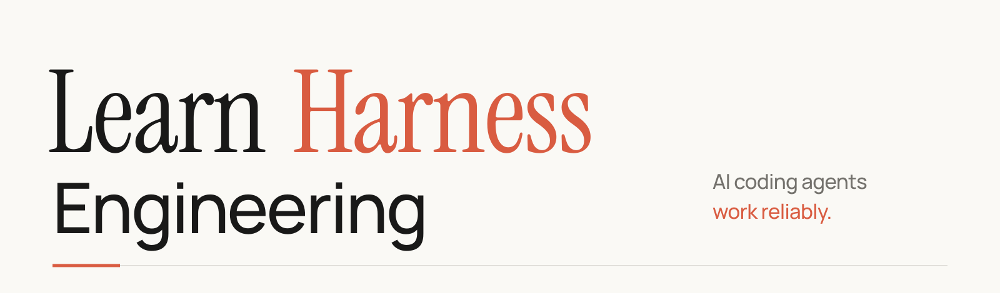

<h1 align="center">
  <picture>
    <source media="(prefers-color-scheme: dark)" srcset="assets/readme/harness-wordmark-dark.svg">
    
  </picture>
</h1>

<p align="center"><strong>A condensed, project-based course on building the environment, state, verification, and control mechanisms that make AI coding agents reliable.</strong></p>

<p align="center">
  <a href="https://dsc-itnu.github.io/learn-harness-engineering/">Read the course site</a>
</p>

> Maintained by [DSC ITNU](https://github.com/dsc-itnu). Adapted from [walkinglabs/learn-harness-engineering](https://github.com/walkinglabs/learn-harness-engineering) (MIT). Compared to the original: English only, shorter lectures (same 14, same examples), and the only frontier harness breakdown kept is Codex.

## Course at a glance

- **14 lectures**, each answering one question about why agents fail and what the harness must provide.
- **8 projects** on one Electron knowledge-base app; each solution becomes the next starter.
- **Resource library** with templates, checklists and reference playbooks (incl. the OpenAI advanced pack).
- **[Codex harness breakdown](docs/en/harness-designs/codex/index.md)**: how a frontier product implements the five subsystems.
- **Skills and tools**: [`harness-creator`](./skills/harness-creator/) and [`audit-harness.sh`](./tools/audit-harness.sh).

## Lectures

| Session | Question | Core Idea |
|---------|----------|-----------|
| [L01](./docs/en/lectures/lecture-01-why-capable-agents-still-fail/index.md) | Why do strong models still fail on real tasks? | The capability gap between benchmarks and real engineering |
| [L02](./docs/en/lectures/lecture-02-what-a-harness-actually-is/index.md) | What does "harness" actually mean? | Five subsystems: instructions, state, verification, scope, lifecycle |
| [L03](./docs/en/lectures/lecture-03-why-the-repository-must-become-the-system-of-record/index.md) | Why must the repo be the single source of truth? | If the agent can't see it, it doesn't exist |
| [L04](./docs/en/lectures/lecture-04-why-one-giant-instruction-file-fails/index.md) | Why does one giant instruction file fail? | Progressive disclosure: give a map, not an encyclopedia |
| [L05](./docs/en/lectures/lecture-05-why-long-running-tasks-lose-continuity/index.md) | Why do long-running tasks lose continuity? | Persist progress to disk; pick up where you left off |
| [L06](./docs/en/lectures/lecture-06-why-initialization-needs-its-own-phase/index.md) | Why does initialization need its own phase? | Verify the environment is healthy before the agent starts work |
| [L07](./docs/en/lectures/lecture-07-why-agents-overreach-and-under-finish/index.md) | Why do agents overreach and under-finish? | One feature at a time; explicit definition of done |
| [L08](./docs/en/lectures/lecture-08-why-feature-lists-are-harness-primitives/index.md) | Why are feature lists harness primitives? | Machine-readable scope boundaries the agent can't ignore |
| [L09](./docs/en/lectures/lecture-09-why-agents-declare-victory-too-early/index.md) | Why do agents declare victory too early? | Verification gaps: confidence ≠ correctness |
| [L10](./docs/en/lectures/lecture-10-why-end-to-end-testing-changes-results/index.md) | Why does end-to-end testing change results? | Only a full-pipeline run counts as real verification |
| [L11](./docs/en/lectures/lecture-11-why-observability-belongs-inside-the-harness/index.md) | Why does observability belong inside the harness? | If you can't see what the agent did, you can't fix what it broke |
| [L12](./docs/en/lectures/lecture-12-why-every-session-must-leave-a-clean-state/index.md) | Why must every session leave a clean state? | The next session's success depends on this session's cleanup |
| [L13](./docs/en/lectures/lecture-13-loop-engineering/index.md) | Why do you need to stop prompting your agent? | From manual driving to automated loops — goal loops, timer loops, and maker-checker separation |
| [L14](./docs/en/lectures/lecture-14-graph-engineering/index.md) | Why does a single loop grow into a graph? | From single loops to graph engineering — nodes, edges, shared state, routing, and when a graph is actually worth drawing |

## Projects

| Project | What You Do | Harness Mechanism |
|---------|------------|-------------------|
| [P01](./docs/en/projects/project-01-baseline-vs-minimal-harness/index.md) | Run the same task twice: prompt-only vs. rules-first | Minimal harness: AGENTS.md + init.sh + feature_list.json |
| [P02](./docs/en/projects/project-02-agent-readable-workspace/index.md) | Restructure the repo so the agent can read it | Agent-readable workspace + persistent state files |
| [P03](./docs/en/projects/project-03-multi-session-continuity/index.md) | Make the agent pick up from where it left off | Progress log + session handoff + multi-session continuity |
| [P04](./docs/en/projects/project-04-incremental-indexing/index.md) | Stop the agent from doing too much or too little | Runtime feedback + scope control + incremental indexing |
| [P05](./docs/en/projects/project-05-grounded-qa-verification/index.md) | Make the agent verify its own work | Self-verification + grounded Q&A + evidence-based completion |
| [P06](./docs/en/projects/project-06-runtime-observability-and-debugging/index.md) | Build a complete harness from scratch (capstone) | Full harness: all mechanisms + observability + ablation study |
| [P07](./docs/en/projects/project-07-loop-engineering-first-loop/index.md) | Build your first automated loop | Goal loops, timer loops, maker-checker separation, loop state management |
| [P08](./docs/en/projects/project-08-graph-engineering-first-graph/index.md) | Draw your workflow as a graph | Explicit nodes/edges/state/routing, parallel fan-out/fan-in, rollback edges, human-in-the-loop approval |

Each project's solution becomes the next project's starter.

## Requirements

Claude Code, Codex, or another coding agent that can edit files and run commands; comfort with the terminal, git and one common application stack.

## Local preview

```sh
npm install
npm run docs:dev        # dev server
npm run docs:build      # production build
```

## Tools

- [**audit-harness.sh**](./tools/audit-harness.sh): A shell-based audit script that checks an existing repo against all five harness subsystems (L03–L12). Exits 0 when all CRITICAL items pass. No Node.js required — complements `harness-creator`'s `validate-harness.mjs`.

```bash
bash tools/audit-harness.sh /path/to/your/repo
```

## Deployment

Pushing to `main` builds the VitePress site and publishes it to GitHub Pages via `.github/workflows/deploy-pages.yml`.

## Acknowledgments

Original course by [walkinglabs](https://github.com/walkinglabs/learn-harness-engineering), inspired by [learn-claude-code](https://github.com/shareAI-lab/learn-claude-code). Licensed under MIT.
