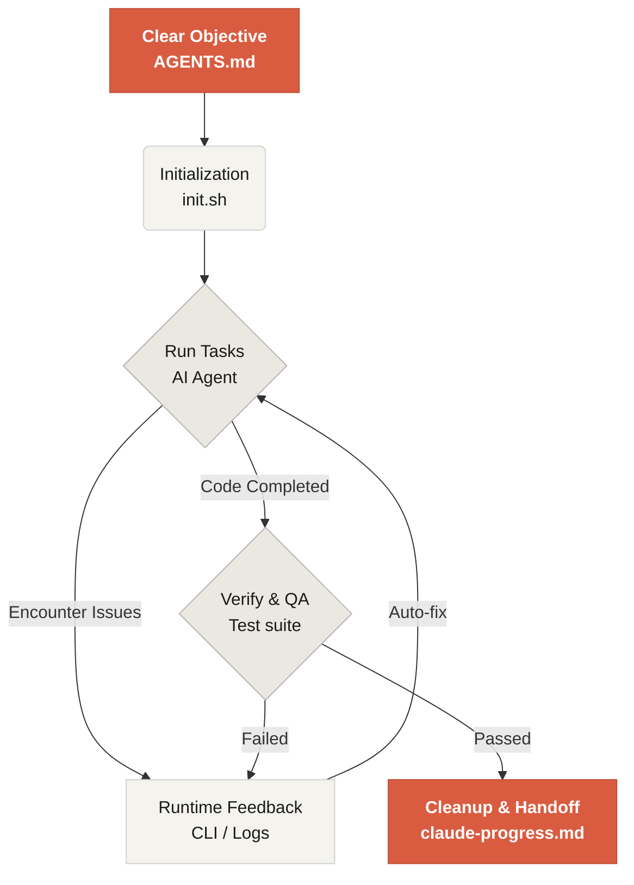

# Welcome to Learn Harness Engineering

Learn Harness Engineering is a course on engineering AI coding agents. It synthesizes the leading Harness Engineering theory and practice. Core references:
- [OpenAI: Harness engineering: leveraging Codex in an agent-first world](https://openai.com/index/harness-engineering/)
- [Anthropic: Effective harnesses for long-running agents](https://www.anthropic.com/engineering/effective-harnesses-for-long-running-agents)
- [Anthropic: Harness design for long-running application development](https://www.anthropic.com/engineering/harness-design-long-running-apps)
- [Awesome Harness Engineering](https://github.com/walkinglabs/awesome-harness-engineering)

Through environment design, state management, verification, and control systems, this course teaches you to make agentic coding tools like Codex and Claude Code reliable, by constraining them with explicit rules and boundaries.

## Get started

The course has theoretical lectures, hands-on projects, and a copy-ready resource library.

  <a href="./lectures/lecture-01-why-capable-agents-still-fail/" class="card">
    <h3>Lectures</h3>
    
Understand why strong models still fail and learn the theory behind effective harnesses.

  </a>
  <a href="./projects/" class="card">
    <h3>Projects</h3>
    
Hands-on practice building a reliable agentic environment from scratch.

  </a>
  <a href="./resources/" class="card">
    <h3>Resource Library</h3>
    
Copy-ready templates (AGENTS.md, feature_list.json) to use in your own repositories.

  </a>
  <a href="./harness-designs/" class="card">
    <h3>Frontier Harness Design Breakdown</h3>
    
How Codex designs its harness, mapped to the course framework.

  </a>

## The Core Mechanism of a Harness

A harness doesn't "make the model smarter"; it builds a closed-loop **working system** around the model:

## What you will learn

Key concepts you will master:

<ul class="index-list">
  <li><strong>Constrain agent behavior</strong> with explicit rules and boundaries.</li>
  <li><strong>Maintain context</strong> across long-running, multi-session tasks.</li>
  <li><strong>Stop agents</strong> from declaring victory too early.</li>
  <li><strong>Verify work</strong> using full-pipeline tests and self-reflection.</li>
  <li><strong>Make runtime observable</strong> and debuggable.</li>
</ul>

## Next steps

<ul class="index-list">
  <li><a href="./lectures/lecture-01-why-capable-agents-still-fail/">Lecture 01: Why Capable Agents Still Fail</a>: Start with the theory behind harness engineering.</li>
  <li><a href="./projects/project-01-baseline-vs-minimal-harness/">Project 01: Baseline vs Minimal Harness</a>: Walk through your first real task.</li>
  <li><a href="./resources/templates/">Templates</a>: Grab the minimal harness pack (AGENTS.md, feature_list.json, claude-progress.md) for your own projects.</li>
</ul>
