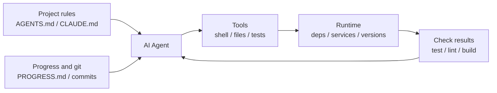

> Code examples: [code/](https://github.com/dsc-itnu/learn-harness-engineering/blob/main/docs/en/lectures/lecture-02-what-a-harness-actually-is/code/)
> Practice project: [Project 01. Prompt-only vs. rules-first](./../../projects/project-01-baseline-vs-minimal-harness/index.md)

# Lecture 02. What a Harness Actually Is

> Full templates and example snippets: [inline-examples](./code/inline-examples.md)

When people say "harness" they usually mean a prompt file. A prompt file is not a harness. A harness has five subsystems: instructions, tools, environment, state, and feedback.

## Start with an Analogy

A new engineer dropped into a project with no README, no comments, no test instructions would waste time figuring out the project. An agent is worse off: it can't ask anyone and sees only the files and commands you give it. OpenAI's principle is "the repo IS the spec": context lives in the repository via structured instruction files, explicit verification commands and clear directories. Anthropic stresses state persistence, explicit recovery paths and structured progress tracking. Both say: **everything outside the model determines how much of its capability is realized.**

- **Claude Code**: reads `CLAUDE.md`, runs shell and tests locally, keeps history; but without test instructions it can't verify.
- **Cursor**: `.cursorrules` as instructions, terminal as tool; weak state, as closing the IDE loses context.
- **Codex** (OpenAI): git worktrees isolate each task, plus a local observability stack (logs, metrics, traces); far better with an `AGENTS.md` and verification commands than in bare repos.
- **AutoGPT**: the cautionary tale; no structured state so context piles up, no precise feedback so it loops. Its harness doesn't work, not "AutoGPT."

## Core Concepts

- **Harness**: everything outside model weights. OpenAI: the engineer's job is designing environments, expressing intent, building feedback loops. Anthropic calls its Claude Agent SDK a "general-purpose agent harness."
- **Repo as single source of truth**: what the agent can't see doesn't exist (OpenAI's "system of record").
- **A map, not a manual**: `AGENTS.md` is a ~100-line directory page; split the rest into `docs/` for on-demand reading.
- **Constrain, don't micromanage**: executable rules over enumerated instructions ("enforce invariants, don't micromanage implementation"). Anthropic found agents confidently praise their own work, so separate doer from checker.
- **Remove one at a time**: ablate components to see which matter most now. Anthropic found that as models improve some components stop being critical, but new ones emerge.

## The Five-Subsystem Harness Model

- **Instructions**: `AGENTS.md`/`CLAUDE.md` with overview, tech stack and versions, first-run commands, hard constraints, links to docs.
- **Tools**: enough access (shell included, since an agent that can't `pip install` is stuck) but least privilege.
- **Environment**: self-describing; locked dependencies, `.nvmrc`/`.python-version`, Docker or devcontainers.
- **State**: a `PROGRESS.md` (done, in progress, blocked), updated at session end and read at start.
- **Feedback**: highest ROI; list commands in `AGENTS.md` (`pytest tests/ -x`, `mypy src/ --strict`, `ruff check src/`, `make check`).

Missing any one makes the harness incomplete.

**Controlled variable exclusion test**: fix the model, remove subsystems one at a time; the biggest drop marks the highest marginal contribution for this task. Strengthening it still depends on failure attribution. Near-zero impact may mean redundant, poorly designed, or unexercised, not useless. The test shows what is most valuable now, not where the bottleneck is; for that, examine failure records (task unclear, context insufficient, environment unreproducible, verification missing, state broken).

## A Team's Real Story

A team using GPT-4o on a TypeScript + React app (~20,000 lines) added components in stages: README only, 1 of 5 runs succeeded (20%; wrong package manager, naming violations, couldn't run tests); plus `AGENTS.md` with versions, conventions, architecture decisions, 60%; plus verification commands (`yarn test && yarn lint && yarn build`), 80%; plus progress file templates, 80-100%. Same model, 20% to near 100%.

## Key Takeaways

- Harness = Instructions + Tools + Environment + State + Feedback; all five are essential.
- If it's not model weights, it's harness, and it determines how much capability is realized.
- Feedback has usually the lowest investment and highest return; fix verification commands first.
- Use exclusion tests for marginal value; use failure attribution to find bottlenecks.
- Harness rots like code; audit and pay down harness debt.

## Further Reading

- [OpenAI: Harness Engineering](https://openai.com/index/harness-engineering/)
- [Anthropic: Effective Harnesses for Long-Running Agents](https://www.anthropic.com/engineering/effective-harnesses-for-long-running-agents)
- [HumanLayer: Harness Engineering for Coding Agents](https://www.humanlayer.dev/blog/skill-issue-harness-engineering-for-coding-agents)
- [SWE-agent: Agent-Computer Interfaces](https://github.com/princeton-nlp/SWE-agent)
- [Thoughtworks: Harness Engineering on Technology Radar](https://www.thoughtworks.com/radar)

## Exercises

1. **Five-tuple audit**: score each subsystem 1-5 on a real project, spend 30 minutes improving the lowest, observe the change.
2. **Exclusion test**: on one model and task, remove instructions, feedback, state one at a time and rank marginal value; also log failures for root-cause attribution.
3. **Affordance analysis**: find where the agent "wants to but can't"; classify it as Gulf of Execution (doesn't know how to operate) or Evaluation (doesn't know if it's right) and design a fix.
