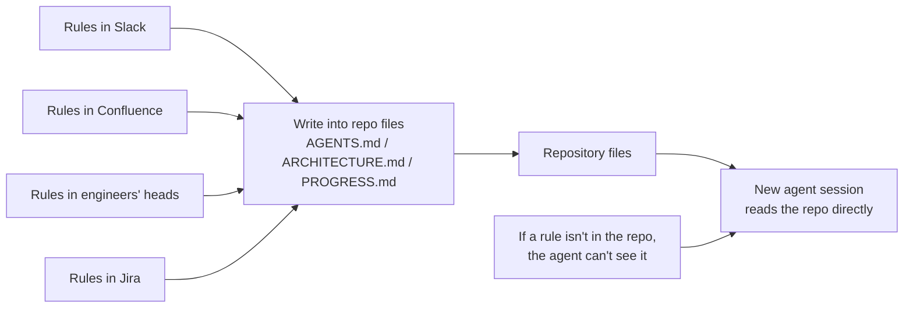
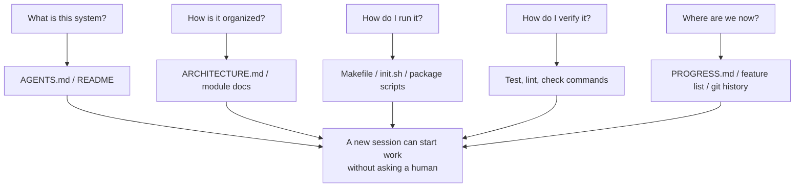

> Code examples: [code/](https://github.com/dsc-itnu/learn-harness-engineering/blob/main/docs/en/lectures/lecture-03-why-the-repository-must-become-the-system-of-record/code/)
> Practice project: [Project 02. Make the Agent Read the Project and Pick Up Where It Left Off](./../../projects/project-02-agent-readable-workspace/index.md)

# Lecture 03. Making the Repository the Single Source of Truth

Architecture decisions scattered across Confluence, Slack, Jira and senior engineers' heads barely work for humans, who can ask around. For an agent, information not in the repository does not exist. Its only inputs are the system prompt and task, repository files, and tool output; it can't "go ask someone."

## What Belongs on the Map

OpenAI: **information that doesn't exist in the repo, doesn't exist for the agent** ("repo as spec"). Anthropic's long-running agents documentation adds that persistent state is required for long-task continuity, cross-session recoverability determines success, and the repository is the only stable storage. This isn't "write more docs" but "put decisions in the right place": a 50-line `ARCHITECTURE.md` in `src/api/` beats a 500-page unmaintained Confluence doc. Proximity beats length.

## Knowledge Visibility

The "fresh session test": give a brand-new session only the repo and see whether it can answer five questions.

Blank spots force guessing: wrong guesses become bugs, excess guessing wastes context, and every session guesses again.

## Core Concepts

- **Knowledge Visibility Gap**: the share of project knowledge NOT in the repo; bigger gap, higher failure rate.
- **System of Record**: the repo is the sole authority for decisions, constraints, state and verification standards. Write "this road is closed" in the repo rather than asking Old Zhang every time.
- **Fresh Session Test**: how many of the five questions it answers is how complete the map is.
- **Discovery Cost**: context spent finding one key fact; put critical information first, not ten directories deep.
- **Knowledge Decay Rate**: share of entries going stale; out-of-sync docs are worse than none.
- **ACID Analogy**: transaction principles for agent state (below).

## How to Draw a Good Map

1. **Knowledge lives next to code**: a short doc per module (responsibilities, interfaces, constraints).
2. **Standardized entry file**: `AGENTS.md`/`CLAUDE.md`, 50-100 lines, answering what the project is, how to run it, how to verify it.
3. **Minimal but complete**: drop rules that don't change decisions, but every fresh-session question needs an answer.
4. **Update with code**: docs in the module directory, with CI reminders.

Typical layout: root `AGENTS.md`, `PROGRESS.md`, `Makefile`, plus `src/api/ARCHITECTURE.md` and `src/db/CONSTRAINTS.md`.

## Managing Agent State with ACID Principles

- **Atomicity**: a logical operation (endpoint plus tests) is committed whole once verified; failed attempts are discarded.
- **Consistency**: verification predicates (tests pass, zero lint errors) run after each operation; no inconsistent commits.
- **Isolation**: concurrent agents use separate progress files or git branches to avoid write races.
- **Durability**: cross-session knowledge goes in git-tracked files; session memory is temporary.

## OpenAI: Repository Knowledge as the System of Record

OpenAI describes keeping architecture, design decisions, execution plans and progress in versioned repo files while building an internal product with Codex, organized in a structured docs directory with freshness checks and cross-links. This is a documented practice, not a controlled measurement of documentation's effect. OpenAI also reports roughly 1,500 PRs opened and merged over five months by three engineers using Codex (3.5 per engineer per day); the team later grew to seven. These are whole-setup outcomes; the article does not isolate documentation's contribution. [OpenAI: Harness engineering](https://openai.com/index/harness-engineering/)

## Key Takeaways

- Knowledge not in the repo doesn't exist for the agent; externalizing decisions is the most basic harness investment.
- Evaluate the repo with the fresh session test.
- Keep knowledge near code, minimal but complete, updated with code.
- Apply ACID to agent state: atomic commits, consistency checks, isolation, durability.
- Knowledge decay is the biggest enemy; stale docs mislead the agent confidently.

## Further Reading

- [OpenAI: Harness Engineering](https://openai.com/index/harness-engineering/)
- [Anthropic: Effective Harnesses for Long-Running Agents](https://www.anthropic.com/engineering/effective-harnesses-for-long-running-agents)
- [Infrastructure as Code — Martin Fowler](https://martinfowler.com/bliki/InfrastructureAsCode.html)
- [ADR: Architecture Decision Records](https://adr.github.io/)
- [The Twelve-Factor App](https://12factor.net/)

## Exercises

1. **Fresh session test**: ask a context-free session the five questions, record failures, fix the repo until all are answered.
2. **Externalization quantification**: list key decisions, mark inside or outside the repo, compute the gap, plan to get below 10%.
3. **ACID assessment**: check rollback (atomicity), consistent-state checks, concurrent-agent conflicts, and cross-session persistence.
