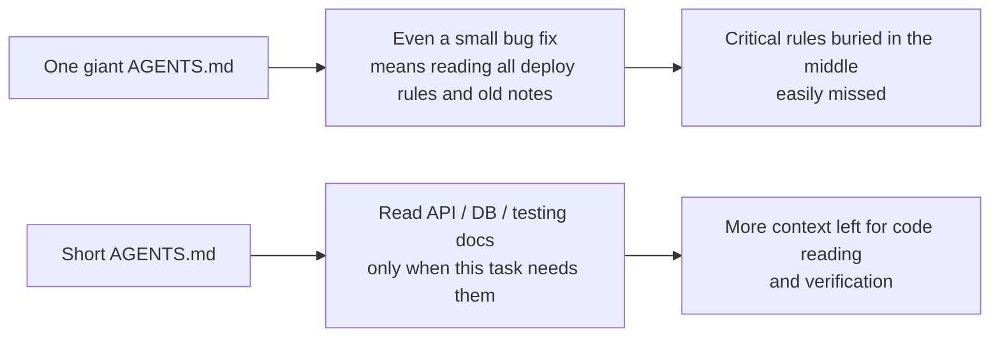
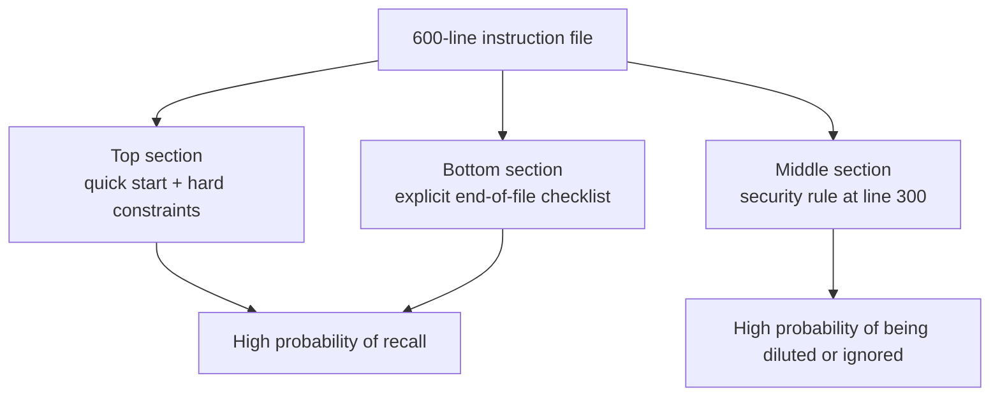

> Code examples: [code/](https://github.com/dsc-itnu/learn-harness-engineering/blob/main/docs/en/lectures/lecture-04-why-one-giant-instruction-file-fails/code/)
> Practice project: [Project 02. Agent-readable workspace](./../../projects/project-02-agent-readable-workspace/index.md)

# Lecture 04. Split Instructions Across Files

> Full templates and example snippets: [inline-examples](./code/inline-examples.md)

An `AGENTS.md` that grows from 300 to 600 lines over three months makes the agent worse: simple fixes burn context on deployment rules, a security constraint at line 300 is ignored, contradictory style rules get picked at random. Only a third of it is relevant to any task. This is the "giant instruction file" trap.

## The Vicious Cycle at the Root

Agent errs, you add a rule, it works briefly, another error, another rule. Costs:

- **Context budget eaten**: a 10-20K-token file in a 200K window looks fine, but tasks also read dozens of files, tool output and history.
- **Lost in the middle**: Liu et al. (2023) showed LLMs use mid-text information far less than start or end; "use parameterized queries" at line 300 will likely be ignored.
- **Priority conflicts**: hard constraints ("never use eval()"), guidelines ("prefer functional style") and history ("fixed a WebSocket leak last week") look identical.
- **Maintenance decay**: deleting is risky, adding feels free, so signal-to-noise falls like technical debt.
- **Contradictions**: rules added at different times conflict ("TypeScript strict" vs. "legacy files may use any").

## Core Concepts

- **Instruction Bloat**: a file taking 10-15% of the window crowds out code reading; 600 lines may be 10,000-20,000 tokens, 8-15% of 128K.
- **Lost in the Middle**: mid-file critical constraints are likely ignored.
- **Instruction SNR**: share of instructions relevant to the task; 50 lines of deploy rules during a bug fix is low.
- **Entry File**: 50-200 lines pointing to detailed docs.
- **Reveal on Demand**: overview first, details when needed, like good UI.
- **Can't Tell What Matters**: uniform format hides hard constraints among soft guidelines.

## Instruction Architecture





## How to Split

Keep frequently needed information at hand, tuck away the occasional, drop the never-used. `AGENTS.md` (50-200 lines) holds a one-or-two-sentence overview, first-run commands, at most 15 hard constraints, and links with applicability conditions:

```markdown
## Hard Constraints
- All APIs must use OAuth 2.0 authentication
## Topic Docs
- API Design Patterns (`docs/api-patterns.md`) — Required reading when adding endpoints
```

Topic docs run 50-150 lines in `docs/` or beside modules, like packing cubes in luggage. Type definitions, interface comments and config notes belong in code. Give each instruction a source, applicability condition and expiry condition; audit and delete outdated, redundant or contradictory entries like unused dependencies. If something must stay in the entry file, put it at the top or bottom, never the middle. OpenAI says entry files should be "short and routing-oriented"; Anthropic says control information for long-running agents should be "concise and high-priority."

## OpenAI: A Short Entry File and Linked Documentation

OpenAI reports a single large AGENTS.md crowded out task context, blurred priorities, accumulated stale rules and was hard to verify; they moved to a ~100-line entry file mapping to a structured docs directory kept up by linters and CI, with no before-and-after success or compliance numbers reported. [OpenAI: Harness engineering](https://openai.com/index/harness-engineering/)

Benefit depends on content and task. An ETH Zurich study found context files did not generally improve success in its settings and raised inference cost by over 20%, recommending minimal human-written requirements; test instructions on their tasks. [ETH Zurich: Evaluating AGENTS.md](https://www.sri.inf.ethz.ch/publications/gloaguen2026agentsmd)

A paired study (gpt-5.2-codex, 124 PR-derived tasks, 10 repositories, with vs. without AGENTS.md) found median runtime fell from 98.57 s to 70.34 s (28.64% lower) and median output tokens from 2,925 to 2,440 (16.58% lower). Tasks changed at most 100 lines across at most five files. It measures efficiency, not file splitting; correctness was out of scope. [Lulla et al., Table 1](https://arxiv.org/html/2601.20404v2)

## Key Takeaways

- "Add a rule" is short-term relief and long-term poison; ask if it belongs in a topic doc.
- The entry file is a router: 50-200 lines of overview, hard constraints and links.
- Put important items at top or bottom; move the rest to topic docs.
- Treat bloat as technical debt: audit; each instruction has source, applicability and expiry.
- Splitting raises SNR so context goes to the task.

## Further Reading

- [OpenAI: Harness Engineering](https://openai.com/index/harness-engineering/)
- [Anthropic: Effective Harnesses for Long-Running Agents](https://www.anthropic.com/engineering/effective-harnesses-for-long-running-agents)
- [Lost in the Middle: How Language Models Use Long Contexts](https://arxiv.org/abs/2307.03172)
- [HumanLayer: Harness Engineering for Coding Agents](https://www.humanlayer.dev/blog/skill-issue-harness-engineering-for-coding-agents)
- [Nielsen Norman Group: Progressive Disclosure](https://www.nngroup.com/articles/progressive-disclosure/)
- [ETH Zurich: Evaluating AGENTS.md: Are Repository-Level Context Files Helpful for Coding Agents?](https://www.sri.inf.ethz.ch/publications/gloaguen2026agentsmd): repository context files; task success, inference cost, keep requirements minimal.
- [Lulla et al., Table 1](https://arxiv.org/html/2601.20404v2)

## Exercises

1. **SNR Audit**: for 5 task types mark each instruction relevant or not, compute SNR, move noise to topic docs.
2. **Reveal on Demand Refactor**: split a 300+ line file into an entry under 100 lines and 3-5 topic docs; compare success on 5+ tasks before and after.
3. **Lost in the Middle Verification**: put a critical constraint at top, middle, bottom (5+ runs each) and compare compliance.
