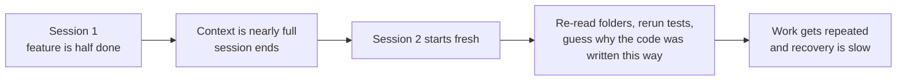
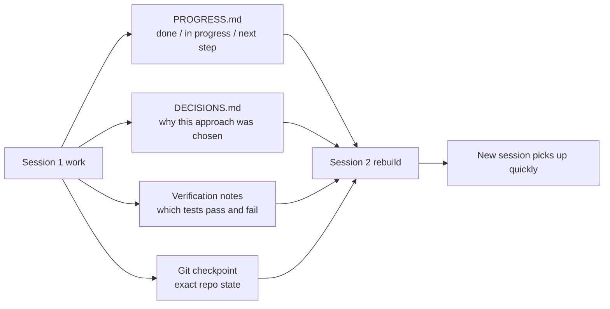

> Code examples: [code/](https://github.com/dsc-itnu/learn-harness-engineering/blob/main/docs/en/lectures/lecture-05-why-long-running-tasks-lose-continuity/code/)
> Practice project: [Project 03. Multi-session continuity](./../../projects/project-03-multi-session-continuity/index.md)

# Lecture 05. Keeping Context Alive Across Sessions

> Full templates and example snippets: [inline-examples](./code/inline-examples.md)

Claude Code works 30 minutes on a feature, context runs low, and a new session starts. It doesn't know what was decided, why A was chosen over B, which files changed, or what state the tests are in. It spends 15 minutes re-exploring and may take an inconsistent approach. This lecture covers why agents lose the thread and how structured state persistence fixes it.

## Context Windows: Not Infinite

Windows are finite, and bigger ones (even 1M tokens) don't fix it: code, decision history, tool output and conversation grow faster. Output is also unevenly valuable: intermediate reasoning holds the "why" (why A over B, why an optimization was skipped), the final code holds only the "what." Compaction keeps the latter, so the next session may "optimize" away a deliberate decision.

Anthropic observed that agents sensing low context rush: finishing early, skipping verification, choosing the simple solution. They call this "context anxiety."

## Session Continuity Flow

## Core Concepts

- **Context windows are finite**: long tasks exhaust any size; then compact (lose information) or reset (new session). Both lose something.
- **State persistence files**: let a new session resume unambiguously (progress log, verification records, next actions).
- **Rebuild cost**: time to reach an executable state; a good harness cuts it from 15 minutes to 3.
- **Drift**: gap between the agent's understanding and actual repo state; compounds at every session boundary.
- **Context anxiety**: rushed-finish behavior near context limits; an irrational resource anxiety.
- **Compaction vs. reset**: compaction summarizes in-session (keeps "what," may lose "why"); reset rebuilds a new session from persisted state (clean, but depends on artifact completeness).

## What Happens When Continuity Breaks

- Re-decided choices: the new agent lacks the earlier analysis and picks A instead of B.
- Duplicate or conflicting work, because completed work is unrecorded.
- Silent direction drift: each session understands the goals slightly differently.
- Verification gap: unrecorded test results force every session to re-diagnose from scratch.

OpenAI's harness engineering article treats the repository as an "operational record" leaving traceable evidence. Anthropic's long-running agents documentation recommends "handoff files": current state, known issues, next actions.

## Practical Approaches to State Persistence

Treat the agent like an engineer whose short-term memory is wiped every session: before "clocking out," write down what the next shift needs.

1. **Progress file (PROGRESS.md)**: current commit, test status (e.g. 42/43 passing), completed, in progress, known issues, next steps.
2. **Decision log (DECISIONS.md)**: what was decided, why, rejected alternatives, constraints, e.g. "Redis for preferences cache; rejected materialized view; TTL 5 min."
3. **Git commits as checkpoints**: commit each atomic unit with what/why messages; free versioned snapshots.
4. **init.sh / clock-in and clock-out routines in `AGENTS.md`**: start by reading PROGRESS.md and DECISIONS.md and running `make check`; end by updating PROGRESS.md, running `make check`, and committing.

**Mixed strategy**: short tasks (under 30 minutes) fit one session; long tasks need progress files and decision logs. If a task needs more than 60% of the window, start preparing the handoff.

### A Deeper Look at Context Anxiety

Anthropic's March 2026 research: on Sonnet 4.5, agents near the window limit show strong "rushed finish" behavior.

- **Compaction**: keeps continuity and the "what," loses the "why," and doesn't remove anxiety (the agent knows context was once large).
- **Context reset**: clean mental state with no anxiety, but depends on handoff completeness.

For Sonnet 4.5 anxiety is severe enough that compaction alone isn't sufficient and reset is critical; for Opus 4.5 it is greatly diminished and compaction suffices. **Harness design must fit the target model, not a one-size-fits-all template.**

> Source: [Anthropic: Harness design for long-running application development](https://www.anthropic.com/engineering/harness-design-long-running-apps)

## Anthropic: Handoff Across Coding Sessions

A Claude website clone: the initializer expanded the spec into 200+ features marked failing, and created init.sh, a progress file and an initial git commit. Later sessions read progress and git history, worked incrementally, verified, and left updates. This documents a mechanism, not completion or rebuild percentages; the companion code is a teaching simulation. [Anthropic](https://www.anthropic.com/engineering/effective-harnesses-for-long-running-agents)

LangChain, same gpt-5.2-codex model on Terminal Bench 2.0 (89 tasks): 52.8% to 66.5% (+13.7 points) from verification guidance, middleware and context management together, not progress files alone. [LangChain: Improving Deep Agents](https://www.langchain.com/blog/improving-deep-agents-with-harness-engineering)

## Key Takeaways

- Context windows are finite; long tasks span sessions and lose information.
- Better state persistence, not bigger windows: progress files, decision logs and git checkpoints together.
- Before "clocking out," write down what was done, why, and what's next.
- Rebuild cost is the key metric; aim for under 3 minutes.
- Mixed strategy: short tasks in-session, long tasks with structured artifacts.

## Further Reading

- [Anthropic: Effective Harnesses for Long-Running Agents](https://www.anthropic.com/engineering/effective-harnesses-for-long-running-agents)
- [OpenAI: Harness Engineering](https://openai.com/index/harness-engineering/)
- [Lost in the Middle: How Language Models Use Long Contexts](https://arxiv.org/abs/2307.03172)
- [Claude Code Documentation](https://docs.anthropic.com/en/docs/claude-code)
- [HumanLayer: Harness Engineering for Coding Agents](https://www.humanlayer.dev/blog/skill-issue-harness-engineering-for-coding-agents)
- [LangChain: Improving Deep Agents](https://www.langchain.com/blog/improving-deep-agents-with-harness-engineering)

## Exercises

1. **State persistence measurement**: over a 3+ session task, compare context spent re-orienting with and without progress files.
2. **Handoff template design**: four fields (commit hash, test pass rate, blockers, next actions); have a fresh session restore from it alone and iterate on ambiguities.
3. **Mixed strategy experiment**: over 5 sessions compare (a) fresh sessions + progress files, (b) one long compacted session, (c) mixed, on rebuild time, completion rate and decision consistency.
