> Code examples: [code/](https://github.com/dsc-itnu/learn-harness-engineering/blob/main/docs/en/lectures/lecture-06-why-initialization-needs-its-own-phase/code/)
> Practice project: [Project 03. Multi-session continuity](./../../projects/project-03-multi-session-continuity/index.md)

# Lecture 06. Make the Agent Initialize Before Every Work Session

Told "add a search feature," an agent jumps into coding, then spends 30 minutes discovering a misconfigured test framework and a wrong migration format. Most of the session goes to "figuring out how this project works." A separate phase should ready the environment, run verification and learn the structure first.

## Two Fundamentally Different Kinds of Work

Implementation maximizes verified features; initialization maximizes the reliability and efficiency of all later implementation. Mixed, the agent faces a multi-objective problem with no stated priority and gravitates to visible feature code over infrastructure whose value shows only later.

## Initialization Lifecycle

```mermaid
flowchart TB
    subgraph Wrong["Mixed into one session (wrong)"]
        W1["Start feature work immediately"] --> W2["Discover env and test gaps mid-task"]
        W2 --> W3["Accumulate unverified code"]
        W3 --> W4["Next session must rediscover project state"]
    end

    subgraph Right["Dedicated initialization phase (right)"]
        R1["Session 1: environment runnable"] --> R2["Example test passing"]
        R2 --> R3["Startup readiness checklist + task list written"]
        R3 --> R4["Clean checkpoint committed"]
        R4 --> R5["Later sessions start directly on verified tasks"]
    end
```

## What Happens When You Mix Them

- **Shaky infrastructure**: about 80% of effort goes to features; tests are unverified, lint loose, no progress file. Hidden in session 1, it surfaces in session 2.
- **Unverified accumulation**: code written before tests work may be flawed and must be redone.
- **Wasted context budget**: session 1 finishes half the features and session 2 still must learn the project.
- **Implicit assumption landmines**: session 1 picks Vitest, session 2 doesn't know and adds Jest; two frameworks coexist.

Anthropic's long-running application research recommends separating the phases: a dedicated initialization phase gave 31% higher multi-session feature completion, and its cost was recovered within 3-4 sessions. OpenAI's Codex harness guide stresses "repository as operational record": set clear structure from the first run or every session re-infers conventions.

## Core Concepts

- **Initialization Phase**: first phase; establishes prerequisites only, no feature development. Output is infrastructure.
- **Startup Readiness Checklist**: a fresh session can start, test, see progress, and pick up next steps. All four required.
- **From Scratch vs From Template**: templates, with infrastructure in place, far outperform inferring structure from an empty directory.
- **Always Ready to Hand Off**: a fresh agent can take over from repo contents alone.
- **Time from Start to First Passing Test**: core metric of initialization efficiency.
- **Success Rate of Subsequent Sessions**: share of later sessions that work without implicit knowledge; best measure of quality.

## How to Do Initialization Right

The first session does only initialization and produces:

1. **Runnable environment**: starts, dependencies installed.
2. **Verifiable test framework**: at least one example test passes.
3. **Startup readiness checklist**: start/test/check commands (`make setup`, `make dev`, `make test`, `make check`), current state, project structure.
4. **Task breakdown**: ordered tasks, each with acceptance criteria (e.g. "pytest tests/test_auth.py all passing").
5. **Git checkpoint**: a clean commit all later work starts from.

**Use a template** (create-react-app, fastapi-template, etc.) instead of an empty directory, leaving only project-specific setup.

**Completion criteria** are the four readiness conditions, not code written: `make setup` works from scratch, at least one passing test, a new session can answer "how to run/test" from the repo alone, 3+ tasks in the breakdown, all committed. Templates are in `code/`.

## Real-World Example

A React frontend, two approaches:

- **Mixed**: session 1 built scaffolding and the first feature, leaving no start/test docs, progress file or task breakdown. Session 2 spent about 20 minutes inferring structure, tests and build.
- **Dedicated**: session 1 used a template, configured Vitest + React Testing Library, verified one example test, wrote the checklist and task breakdown, and committed. Session 2 rebuilt in under 3 minutes and worked from the task list.

Total rebuild time over the project was about 60% higher for the mixed approach; the extra 20 minutes up front was recovered many times over.

## Key Takeaways

- Different optimization targets; mixing drags both down.
- Initialization outputs infrastructure: runnable environment, verifiable tests, readiness checklist, task breakdown.
- Validate with the four conditions: start, test, see progress, pick up next steps.
- Templates beat scratch.
- Initialization time is recovered within 3-4 sessions; it is upfront investment.

## Further Reading

- [Anthropic: Effective Harnesses for Long-Running Agents](https://www.anthropic.com/engineering/effective-harnesses-for-long-running-agents)
- [OpenAI: Harness Engineering](https://openai.com/index/harness-engineering/)
- [HumanLayer: Harness Engineering for Coding Agents](https://www.humanlayer.dev/blog/skill-issue-harness-engineering-for-coding-agents)
- [Infrastructure as Code — Martin Fowler](https://martinfowler.com/bliki/InfrastructureAsCode.html)
- [SWE-agent: Agent-Computer Interfaces](https://github.com/princeton-nlp/SWE-agent)

## Exercises

1. **Startup readiness checklist design**: write one for your project, give a fresh session only the repo, and treat each problem it hits as a missing clause.
2. **Comparison experiment**: (A) initialize and implement together vs. (B) one initialization session first; after 4 sessions compare time to first passing test, rebuild cost and completion rate.
3. **Initialization acceptance checklist**: have a fresh session run each item; the failures show where to strengthen the harness.
