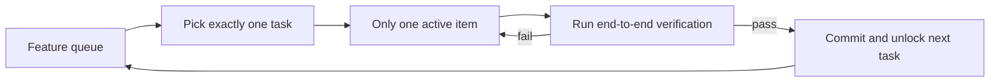
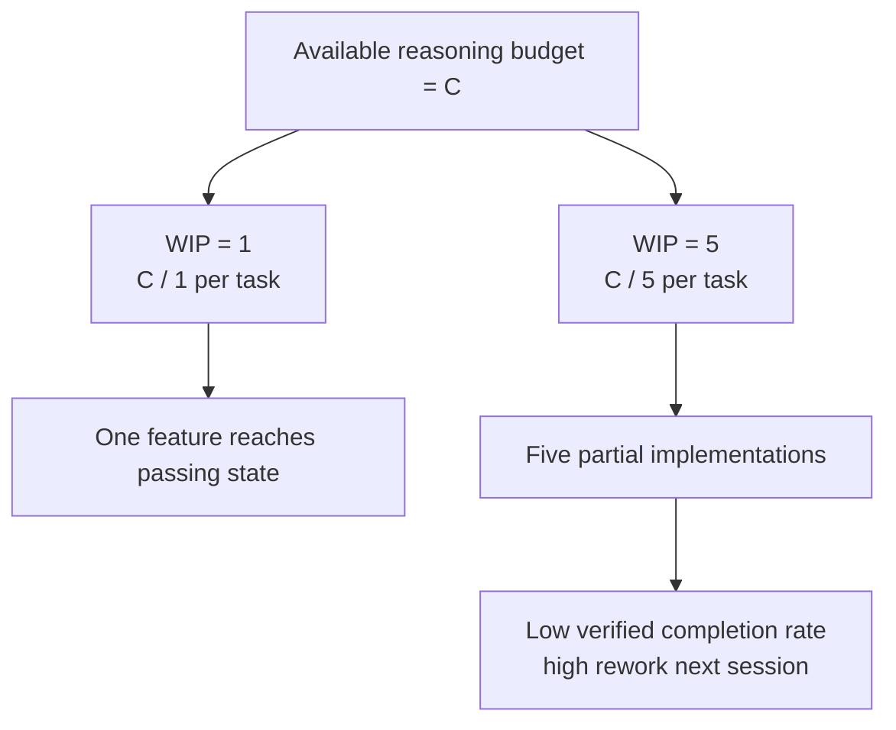

> Code examples: [code/](https://github.com/dsc-itnu/learn-harness-engineering/blob/main/docs/en/lectures/lecture-07-why-agents-overreach-and-under-finish/code/)
> Practice project: [Project 04. Use runtime feedback to correct agent behavior](./../../projects/project-04-incremental-indexing/index.md)

# Lecture 07. Draw Clear Task Boundaries for Agents

Asked to "add user authentication," Claude Code also changes the schema, routes, frontend and error middleware. Two hours later: 12 files, 800 lines, nothing works end-to-end. Agents "do a little extra," and doing too much at once ensures nothing is done well.

Anthropic's "Effective harnesses for long-running agents" says broad prompts make agents "start multiple things at once" rather than "finish one thing first." OpenAI's Codex practices found completion rates plummet without explicit scope controls. This is a harness problem: you didn't draw the boundary.

## Attention Is a Finite Resource

With context capacity C and k active tasks, each gets about C/k. Below the minimum for one task, none finish. Asked for "user registration," Claude Code might: create a User model, write the route, add a mail service for email verification, bring in bcrypt, refactor the error middleware, reorganize tests. All six end half-done, unverified and tangled.

Anthropic's data: a "small next step" strategy (WIP=1) shows 37% higher task completion than broad prompts. Lines generated are weakly negatively correlated with completion.

## WIP=1 Workflow

## Core Concepts

- **Overreach**: activating more tasks than optimal (5 features, 0 passing end-to-end).
- **Under-finish**: share of activated tasks passing verification falls below threshold.
- **WIP Limit**: from Kanban; WIP=1 is the safest default.
- **Completion Evidence**: verifiable condition for "done"; otherwise "looks fine" replaces "passes tests."
- **Scope Surface**: DAG of work units and dependencies; states not_started, active, blocked, passing.
- **Completion Pressure**: harness constraint (WIP limits plus evidence) forcing the current task to finish first.

## Overreach and Under-finish Are Two Sides of the Same Coin

Overreach dilutes attention, causing under-finish; the half-finished code raises complexity and drives more overreach. By Little's Law (L = lambda * W), high work-in-progress L raises each task's lead time W and failure probability. Steve McConnell's *Rapid Development* documents scope creep as the leading cause of project failure. Humans feel "I've done enough"; agents don't, and "let me fix this too" costs the model almost nothing.

## How to Do It Right

1. **Enforce WIP=1** in CLAUDE.md/AGENTS.md: one feature at a time, start the next only after end-to-end verification, no "also refactoring" feature B.
2. **Define completion evidence per task**: done is behavior verification passing, e.g. `F01: User Registration; Verification: curl -X POST /api/register ... | jq .status == 201; State: passing`.
3. **Externalize the scope surface** in a machine-readable file any session can read.
4. **Monitor VCR** (verified completion rate = verified / activated); block new activations when VCR < 1.0.

## Real-World Case

A REST API with 8 features:

- **Unconstrained**: 5 features at once in session 1, ~800 lines across 12 files, 20% end-to-end pass (only registration worked). By session 3, 3 of 8 complete.
- **WIP=1**: registration only in session 1, ~200 lines across 4 files, 100% passing, clean commit. By session 4, 7 of 8 complete (the 8th blocked externally).

Less total code (800 vs 1200 lines), more effective code; completion 87.5% vs 37.5%.

## Key Takeaways

- **WIP=1 is the default safe setting**; don't parallelize.
- **Completion evidence must be executable**: "curl returns 201," not "looks fine."
- **Externalize the scope surface** as a repo file.
- **Overreach and under-finish are symbiotic**; fixing one fixes the other.
- **"Do less but finish" beats "do more but leave half-done."**

## Further Reading

- [Effective harnesses for long-running agents - Anthropic](https://www.anthropic.com/engineering/effective-harnesses-for-long-running-agents) — Anthropic's engineering blog, detailed discussion of the "small next step" strategy
- [Harness Engineering - OpenAI](https://openai.com/index/harness-engineering/) — OpenAI's complete treatment of harness engineering
- [Kanban: Successful Evolutionary Change - David Anderson](https://www.goodreads.com/book/show/1070822.Kanban) — The classic source on WIP limits
- [Rapid Development - Steve McConnell](https://www.goodreads.com/book/show/125171.Rapid_Development) — Empirical data on scope creep as the leading cause of project failure

## Exercises

1. **Task Atomization**: split a broad requirement into 5+ atomic units, each with a behavior, verification command and dependencies; check WIP=1.
2. **Comparison Experiment**: run one project unconstrained and once with WIP=1; compare verified completion rate, lines and effective code ratio.
3. **Completion Evidence Audit**: classify a recent run's changes as completed, incomplete or scaffolding, and add missing verification commands.
