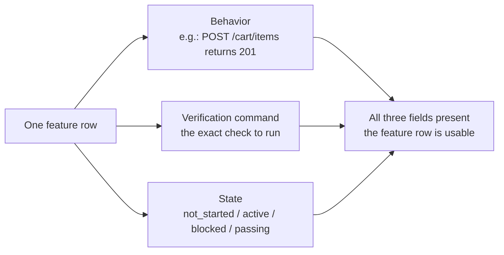
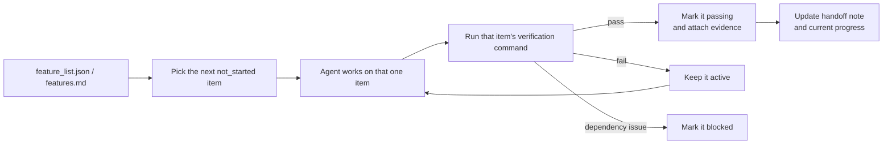

> Code examples: [code/](https://github.com/dsc-itnu/learn-harness-engineering/blob/main/docs/en/lectures/lecture-08-why-feature-lists-are-harness-primitives/code/)
> Practice project: [Project 04. Runtime feedback and scope control](./../../projects/project-04-incremental-indexing/index.md)

# Lecture 08. Use Feature Lists to Constrain What the Agent Does

An agent builds an e-commerce site and reports "done," but the checkout button does nothing and payment isn't connected. You never defined "done," so it used its own: "a lot of code that looks fairly complete."

A feature list is not a memo; it is the structure a harness is built on. The scheduler picks tasks from it, the verifier judges by it, the handoff reporter summarizes from it. Anthropic and OpenAI both stress that **artifacts must be externalized**: feature state lives in a machine-readable repo file, not conversation text.

## Agents Don't Know What "Done" Means

"Add a shopping cart" may be read as "write a Cart component and addToCart," while you meant browse, add and check out end-to-end. Without a list the agent's implicit standard is "no obvious syntax errors." A note like `Did user auth, shopping cart mostly done, still need payments` leaves "mostly done," passed tests and payment blockers unknowable, so a new session spends 20 minutes inferring state and may redo work. Anthropic's data: good progress records cut startup diagnostic time by 60-80%.

## Feature State Machine

## Core Concepts

- **Feature lists are harness primitives**: foundational data the scheduler, verifier and handoff reporter read.
- **Triple structure**: `(behavior description, verification command, current state)`; missing one makes it incomplete.
- **State machine**: `not_started`, `active`, `blocked`, `passing`, with transitions controlled by the harness, not the agent.
- **Pass-state gating**: `active` to `passing` only when verification succeeds; irreversible.
- **Single source of truth**: all "what to do" derives from one list.
- **Back-pressure**: features not yet passing are the pressure on the agent; zero means done.

## Why Feature Lists Must Be "Primitives"

Documents can be ignored; primitives can't be bypassed, like database trigger constraints versus bypassable application-layer checks. The list serves four components: **scheduler** (picks next `not_started`), **verifier** (runs commands, gates transitions), **handoff reporter** (generates summaries), **progress tracker** (state distribution as health metrics).

## How to Do It

1. **Minimal format**: structured Markdown or JSON with the triple plus evidence, e.g. `{"id":"F03","behavior":"POST /cart/items returns 201","verification":"curl ... | jq .status == 201","state":"passing","evidence":"commit abc123"}`.
2. **Harness controls transitions**: the agent only submits a verification request; the harness runs it and decides.
3. **Rules in CLAUDE.md**: list file path (e.g. /docs/features.md), one active feature, verification must pass before `passing`, no self-edited states.
4. **Calibrate granularity** to "completable in one session": "User can add items to cart" is good; "Implement the shopping cart" too broad; "Create the name field on the Cart model" too narrow.

## Real-World Case

An e-commerce platform with 10 features:

- **Memo mode**: after 3 sessions, notes say "shopping cart mostly done but has bugs." A new session needs 20 minutes to infer state and re-implements finished features.
- **Structured mode**: a new session reads the list and in 3 minutes knows F01-F05 are `passing`, F06 `active`, F07-F10 `not_started`; zero rework.

Structured lists gave 45% higher feature completion than free-form tracking, with zero duplicate implementations.

## Key Takeaways

- **Feature lists are the harness's foundation**, not human memos.
- **Every item needs the triple**: behavior + verification command + state.
- **The harness controls transitions**; passing verification is the only upgrade.
- **The list is the single source of truth.**
- **Granularity: completable in one session.**

## Further Reading

- [Building Effective Agents - Anthropic](https://www.anthropic.com/research/building-effective-agents) — Explicitly identifies feature list as the "core data structure" for controlling agent scope
- [Harness Engineering - OpenAI](https://openai.com/index/harness-engineering/) — Emphasizes the principle of "externalizing artifacts"
- [Design by Contract - Bertrand Meyer](https://www.goodreads.com/book/show/130439.Object_Oriented_Software_Construction) — Design by contract principles, the theoretical foundation of feature lists
- [How Google Tests Software](https://books.google.dk/books/about/How_Google_Tests_Software.html?id=VrAx1ATf-RoC&redir_esc=y) — Test pyramid and behavioral specification engineering practices

## Exercises

1. **Feature List Design**: define a minimal JSON schema (id, behavior, verification, state, evidence) and describe a real 5-feature project.
2. **Verification Strictness Comparison**: for 3 features, design loose vs. strict verification and compare false positive rates.
3. **Single Source Principle Audit**: find scope information contradicting the list (conversation requirements, TODO comments) and plan to unify it.
