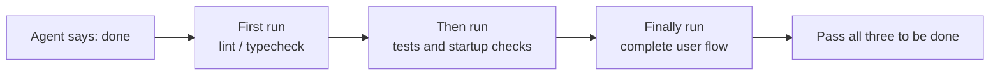
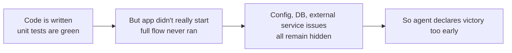

> Code examples for this lecture: [code/](https://github.com/dsc-itnu/learn-harness-engineering/blob/main/docs/en/lectures/lecture-09-why-agents-declare-victory-too-early/code/)
> Hands-on practice: [Project 05. Let the agent verify its own work](./../../projects/project-05-grounded-qa-verification/index.md)

# Lecture 9. Preventing Agents from Declaring Victory Too Early

> Full templates and example snippets: [inline-examples](./code/inline-examples.md)

An agent implements "password reset," its unit tests pass, and it says "done." In reality the email config is missing, the migration failed halfway leaving the schema inconsistent, and the end-to-end flow never ran.

This is systematic: Guo et al. (ICML 2017) showed **modern neural networks are overconfident**, with confidence well above accuracy. Agents are no different, so the harness must replace their "feelings" with execution-based verification.

## The Slippery Slope

The code looks fine (valid syntax, plausible logic, clean static analysis), the harness doesn't enforce full execution, and the agent runs only part (unit but not integration tests), so "looks fine" becomes "complete." Information is lost at every step from spec to code to runtime, and each skipped check compounds it.

## Core Concepts

- **Premature Completion Declaration**: completion asserted from local code-level confidence while system-level correctness is unverified.
- **Confidence Calibration Bias**: systematic gap between self-reported confidence and real quality, significantly positive on complex multi-file tasks.
- **Termination Criteria**: executable harness conditions that must all hold before "done."
- **Verification-Validation Dual Gate**: verification checks the code implements the specified behavior; validation checks end-to-end system behavior. Both must pass.
- **Runtime Feedback Signals**: logs, process states, health checks; the objective basis for judging completion.
- **Completion Priority Constraint**: correctness first, then performance, then style; no refactoring before core functionality is verified.

## Passing Unit Tests ≠ Task Complete

Mocked, isolated unit tests miss interface mismatches, cross-layer state errors and environment dependencies (details and examples in [Lecture 10](../lecture-10-why-end-to-end-testing-changes-results/index.md)).

**"Refactoring while we're at it"** is poison: Claude Code often refactors and restyles before core functionality is verified. Knuth's "premature optimization is the root of all evil" applies: refactoring shifts the verified/unverified boundary and can break implicitly correct paths.

**Self-evaluation bias.** Anthropic's 2026 research found agents evaluating their own work give systematically overly positive assessments, even when a human would judge it clearly substandard, worst on subjective tasks (e.g. "is the layout polished"). Making the agent "more objective" doesn't work, since the same model generates and evaluates. **Separate the "worker" from the "checker"**: an independent, nitpicky evaluator works far better.

| Architecture | Runtime | Cost | Core Features Working? |
|--------------|---------|------|------------------------|
| Single agent (bare run) | 20 mins | $9 | No (game entities unresponsive to input) |
| Three agents (planner + generator + evaluator) | 6 hours | $200 | Yes (game is fully playable) |

Same model (Opus 4.5), same prompt ("build a 2D retro game editor"); only the harness differed: planner expands requirements, generator builds feature by feature, evaluator click-tests with Playwright.

> Source: [Anthropic: Harness design for long-running application development](https://www.anthropic.com/engineering/harness-design-long-running-apps)

## How to Prevent Premature Completion Declarations

1. **Externalize termination judgment.** The harness validates from runtime signals, not agent confidence. In CLAUDE.md: "Definition of Done = end-to-end verification passed, not code written; levels unit, integration, end-to-end; do not proceed to level N+1 if N fails."
2. **Three-layer validation.** Layer 1 syntax/static analysis (cheapest, mandatory); Layer 2 runtime behavior (tests, startup, critical paths: runnable); Layer 3 system-level (E2E, integration, user scenarios: correct).
3. **Actionable error feedback.** OpenAI's Codex practice: error messages for agents include repair instructions. Not `"Test failed"` but `"Test failed: POST /api/reset-password returned 500. Check that the email service config exists in environment variables. The template file should be at templates/reset-email.html."`
4. **Capture runtime signals**: app reached ready state; critical paths ran; database writes and file side effects correct; temporary resources cleaned up.

## Real-World Case

Password reset (database, email, API). The agent changed the schema, wrote the endpoint and template, passed unit tests and declared done. Omitted: (1) the reset link never sent or verified end-to-end, (2) migration failed partway, schema inconsistent, (3) email config missing in the target environment. With enforced termination validation (start the full app and confirm the endpoint, run the full reset flow, verify database consistency), all defects surfaced in-session, saving 5-10x the cost of post-hoc fixes.

## Key Takeaways

- **Agents are systematically overconfident**; written is not correct.
- **Completion judgment must be externalized** to the harness.
- **All three validation layers are essential**, no shortcuts.
- **Errors should include specific repair steps** for self-correction.
- **No refactoring until core functionality is verified.**

## Further Reading

- [On Calibration of Modern Neural Networks - Guo et al.](https://arxiv.org/abs/1706.04599) — Proves modern deep networks are systematically overconfident
- [Building Effective Agents - Anthropic](https://www.anthropic.com/research/building-effective-agents) — The critical role of runtime evidence in completion judgment
- [Harness Engineering - OpenAI](https://openai.com/index/harness-engineering/) — Premature completion declaration is one of the main failure modes of agents
- [The Art of Software Testing - Myers](https://www.goodreads.com/book/show/137543.The_Art_of_Software_Testing) — Classic reference on testing method hierarchies and effectiveness

## Exercises

1. **Termination Validation Design**: Design full validation for a migration plus API task, listing runtime signals and pass/fail criteria; run it and record hidden issues found.
2. **Calibration Bias Measurement**: On 10 varied tasks compare self-reported confidence to actual quality; relate bias to complexity.
3. **Multi-Layer Defense Experiment**: Compare (a) static analysis only, (b) plus unit tests, (c) full three-layer on premature declarations and uncaught defects.
