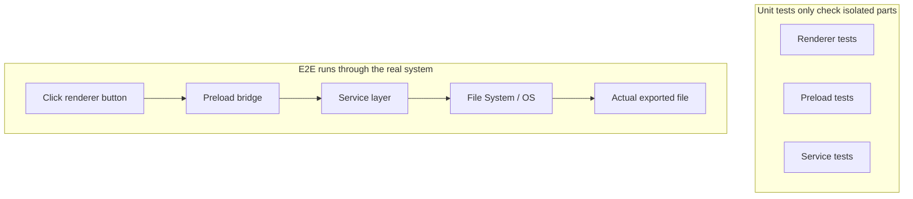
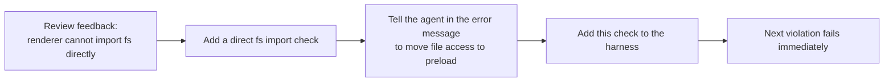

> Code examples for this lecture: [code/](https://github.com/dsc-itnu/learn-harness-engineering/blob/main/docs/en/lectures/lecture-10-why-end-to-end-testing-changes-results/code/)
> Hands-on practice: [Project 05. Let the agent verify its own work](./../../projects/project-05-grounded-qa-verification/index.md)

# Lecture 10. Only a Full Pipeline Run Counts as Real Verification

> Full templates and example snippets: [inline-examples](./code/inline-examples.md)

An agent adds file export to an Electron app (renderer, preload, service); all unit tests pass. Clicking export reveals a wrong path format, an unresponsive progress bar and a memory leak: five boundary defects, none caught. Google's Testing Pyramid says a large unit base is essential, but stopping there misses interaction issues, and agents run only the fastest tests then declare completion. **Only end-to-end testing can prove the absence of system-level defects.**

## The Blind Spots of Unit Tests

Isolation and mocking make unit tests fast but blind to:

- **Interface Mismatch**: renderer passes a relative path, preload expects an absolute one; both mocked tests pass.
- **State Propagation Errors**: a migration changes the schema but the ORM cache holds old entries; fresh mocks never expose it.
- **Resource Lifecycle Issues**: file handles, connections and sockets span components; per-test resources never show leaks or contention.
- **Environment Dependency**: correct under mocks, failing for real due to config, latency or unavailable services.

## End-to-End Testing Changes Behavior, Not Just Results

Knowing E2E will validate its work, the agent (1) considers component interactions, (2) respects architectural boundaries, (3) handles error paths, since E2E includes failure scenarios.





OpenAI's Codex practice: **error messages for agents must include fix instructions.** Not `"Direct filesystem access in renderer"` but `"... All file operations must go through the preload bridge. Move this call to preload/file-ops.ts and invoke it via window.api."` Architecture rules become an auto-correction loop.

## Core Concepts

- **Component Boundary Defects**: A and B pass their own unit tests but interact wrongly; E2E's specialty.
- **Testing Adequacy Gradient**: defects caught by unit <= integration <= end-to-end tests.
- **Architectural Boundary Enforcement Rules**: architecture-document rules (e.g. renderer must not touch the filesystem) as automated CI checks.
- **Review Feedback Promotion**: recurring review comments become automated tests, so the harness strengthens itself.
- **Agent-Oriented Error Messages**: say what went wrong and exactly how to fix it.

## How to Do It

**0. Define architectural boundaries first.** In a tangled architecture E2E only proves "the mess runs." OpenAI: **for agent-generated codebases, set architectural constraints on day one**, since agents copy existing patterns, even inconsistent ones, and drift more each session. They used a "Layered Domain Architecture": per domain, fixed layers Types -> Config -> Repo -> Service -> Runtime -> UI; dependencies flow strictly forward, cross-domain concerns enter via explicit Providers interfaces, everything else is forbidden and enforced by custom linting. Principle: **enforce invariants; don't micromanage implementation** (require "data is parsed at the boundary," not a specific library).

> Source: [OpenAI: Harness engineering: leveraging Codex in an agent-first world](https://openai.com/index/harness-engineering/)

**1. Include an E2E layer.** Validation hierarchy: unit (must pass), integration (must pass), E2E (must pass for cross-component changes); skipping a required level = not complete.

**2. Make rules executable**, one test or lint per constraint, e.g. `grep -r "require('fs')" src/renderer/ && exit 1`.

**3. Write agent-oriented errors** with what, why, fix:

```
ERROR: Found direct import of 'fs' in src/renderer/App.tsx:12
WHY: Renderer process has no access to Node.js APIs for security
FIX: Move file operations to src/preload/file-ops.ts and call via window.api.readFile()
```

**4. Promote review feedback.** Turn each new category of agent error found in review into an automated check.

## Real-World Case

Electron file export (renderer UI, preload filesystem proxy, service-layer transformation). All unit tests passed with mocks; E2E caught all 5 defects, unit tests none:

| Defect | Description | Unit Test | E2E |
|--------|-------------|-----------|-----|
| Interface Mismatch | Inconsistent file path format | Missed | Caught |
| State Propagation | Export progress not sent back to UI via IPC | Missed | Caught |
| Resource Leak | Large file export handles not released | Missed | Caught |
| Permission Issue | Different permissions in packaged environment | Missed | Caught |
| Error Propagation | Service layer exceptions didn't reach UI layer | Missed | Caught |

Cost: test time rose from 2 to 15 seconds, acceptable in an agent workflow.

## Key Takeaways

- **Unit tests are systematically blind to component boundary defects.**
- **E2E also changes how agents write code**, toward integration and boundaries.
- **Architectural rules must be executable**, checked on every commit.
- **Error messages must be designed for agents** with concrete fix steps.
- **Review feedback promotion** turns each defect category into permanent defense.

## Further Reading

- [How Google Tests Software - Whittaker et al.](https://books.google.dk/books/about/How_Google_Tests_Software.html?id=VrAx1ATf-RoC&redir_esc=y) — The classic source of the Testing Pyramid model
- [Harness Engineering - OpenAI](https://openai.com/index/harness-engineering/) — Engineering practices for automated enforcement of architectural constraints
- [Chaos Engineering - Netflix (Basiri et al.)](https://ieeexplore.ieee.org/document/7466237) — Proactively injecting failures to verify system resilience
- [QuickCheck - Claessen & Hughes](https://www.cs.tufts.edu/~nr/cs257/archive/john-hughes/quick.pdf) — Property testing methodology, sitting between example-based testing and formal verification

## Exercises

1. **Cross-Component Defect Detection**: On a three-component task, run unit tests then E2E; classify each extra defect by interaction type.
2. **Architectural Rule Automation**: Turn one project constraint into an executable check with an agent-oriented message; verify on a baseline task.
3. **Review Feedback Promotion**: Convert a recurring review comment into an automated check via the five-step process; compare issue frequency before and after.
