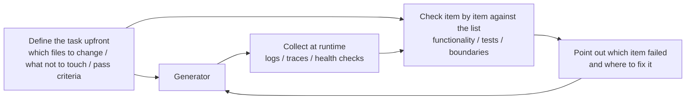

> Code examples: [code/](https://github.com/dsc-itnu/learn-harness-engineering/blob/main/docs/en/lectures/lecture-11-why-observability-belongs-inside-the-harness/code/)
> Practice project: [Project 06. Build a Complete Agent Harness](./../../projects/project-06-runtime-observability-and-debugging/index.md)

# Lecture 11. Making the Agent's Runtime Observable

> Full templates and example snippets: [inline-examples](./code/inline-examples.md)

An agent runs 20 minutes, touches many files, and says "done, but two tests are failing." Why? "Not sure, might be timing." The cause is not capability but missing observability. **Without it, agents decide under uncertainty, evaluations become subjective, and retries become blind wandering.** OpenAI and Anthropic both treat reliability as an evidence problem: the harness must expose runtime behavior and evaluation signals that guide the next decision.

## The Real Cost of Missing Observability

- **"Correct" vs "looks correct."** Review shows what was written; runtime tracing shows what ran (e.g. a boundary-condition error on specific inputs). Both needed.
- **Evaluation becomes mysticism.** Without rubrics and acceptance criteria, the same output gets wildly different assessments, non-reproducibly.
- **Retries become blind guesses**, fixing unrelated paths and burning tokens.
- **Handoff information cliff.** The next session re-diagnoses from scratch; Anthropic observed this can eat 30-50% of session time on long-running agents.

## A Real Claude Code Scenario

Planner-generator-evaluator workflow, task "add dark mode."

**Without observability:** vague plan, result misses implicit expectations, evaluator rejects with "doesn't feel right," generator retries blindly: 3-4 cycles, about 45 minutes, barely acceptable.

**With observability:** the planner's sprint contract lists components, per-component verification and exclusions (no print styles); runtime observability records style loading; the evaluator scores with evidence ("Button color contrast is insufficient (WCAG AA standard 4.5:1, measured 2.1:1)"). One iteration, about 15 minutes: 3x, with observability the only variable.

## Layered Observability

## Core Concepts

- **Runtime observability**: logs, traces, process events, health checks; "what did the system do."
- **Process observability**: plans, rubrics, acceptance criteria; "why should this change be accepted."
- **Task trace**: full decision-path record of a task, like distributed request tracing, so failures can be replayed.
- **Sprint contract**: pre-coding agreement on scope, verification standards and exclusions.
- **Evaluator rubric**: evidence-based structured scoring so different evaluators agree.
- **Layered observability**: both layers designed together; signals explain behavior, artifacts explain intent.

## Why Agents Can't Solve This Themselves

Agents don't know what they don't know, so they log only what they think matters; log formats vary by session; and contracts and rubrics are structured artifacts needing harness support, not print statements.

## How to Build Observability

1. **Harness-collected runtime signals** (not agent-printed): application lifecycle states; critical feature-path entry/checkpoints/exits; data flow between components; abnormal resource use (e.g. growing memory); full error context.
2. **Sprint contracts.** Generator and evaluator agree before each task, e.g. "Dark Mode: scope theme toggle and CSS variables; verify visual regression, main-flow E2E, no FOUC; exclude print styles and third-party components."
3. **Evaluator rubric.** Dimensions such as code correctness, architecture compliance and test coverage, each graded A-D with concrete criteria (A: all tests pass; D: build fails).
4. **Standardize with OpenTelemetry.** A trace per session, a span per task, sub-spans per verification step, standard attributes, so data works with Jaeger and Zipkin.

## Anthropic's Three-Agent Architecture Experiment

In March 2026 Anthropic ran one task ("build a browser-based DAW using the Web Audio API") through a three-agent harness:

| Agent & Phase | Duration | Cost |
|---------------|----------|------|
| Planner | 4.7 min | $0.46 |
| Build round 1 | 2 hr 7 min | $71.08 |
| QA round 1 | 8.8 min | $3.24 |
| Build round 2 | 1 hr 2 min | $36.89 |
| QA round 2 | 6.8 min | $3.09 |
| Build round 3 | 10.9 min | $5.88 |
| QA round 3 | 9.6 min | $4.06 |
| **Total** | **3 hr 50 min** | **$124.70** |

- **Planner:** expands 1-4 sentences into a product spec, told to "be bold in scope" and focus on "product context and high-level technical design rather than detailed technical implementation," because early technical errors cascade downstream.
- **Generator:** builds sprint by sprint, negotiating a sprint contract with the evaluator first, then self-evaluating.
- **Evaluator:** uses Playwright MCP like a real user (UI, API, database state), scoring product depth, functionality, visual design and code quality with hard thresholds; any miss fails the sprint with detailed feedback.

QA round 1: "This is a visually impressive app with good AI integration, but several core DAW features are presentational only, lacking interaction depth: clips can't be dragged/moved, there's no instrument UI panel (synth knobs, drum pads), and no visual effects editor (EQ curves, compressor meters)." Specific, evidence-backed.

Early evaluators found real issues, then talked themselves into dismissing them and approved the work. The fix: read evaluator logs, find where it diverged from human judgment, update the QA prompt; after several rounds scoring became reliable.

> Source: [Anthropic: Harness design for long-running application development](https://www.anthropic.com/engineering/harness-design-long-running-apps)

## Key Takeaways

- **Observability is a harness architecture property**, designed in from the start.
- **Both layers are essential**: runtime signals explain what happened, process artifacts why.
- **Sprint contracts front-load alignment** and prevent foreseeable rejections.
- **Rubrics make evaluation reproducible.**
- **Missing observability wastes 30-50% of session time on redundant diagnosis.**

## Further Reading

- [Observability Engineering - Charity Majors](https://www.honeycomb.io/blog/observability-engineering-book) — Theory and practice framework for modern observability engineering
- [Dapper - Google (Sigelman et al.)](https://research.google/pubs/pub36356/) — Groundbreaking practice in large-scale distributed tracing
- [Harness Design - Anthropic](https://www.anthropic.com/engineering/harness-design-long-running-apps) — Introducing sprint contracts and evaluator rubrics
- [Site Reliability Engineering - Google](https://sre.google/sre-book/table-of-contents/) — Systematic application of observability in production systems

## Exercises

1. **Observability Gap Analysis**: Audit system- and process-layer observability; find states existing signals can't distinguish and propose additions.
2. **Sprint Contract Practice**: Write a contract for a real task and compare efficiency and quality with and without it.
3. **Task Trace Construction**: Record every step of a coding task with OpenTelemetry conventions; find steps whose decisions lack signal support.
