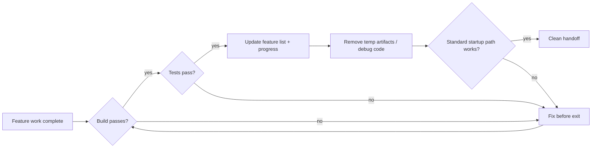
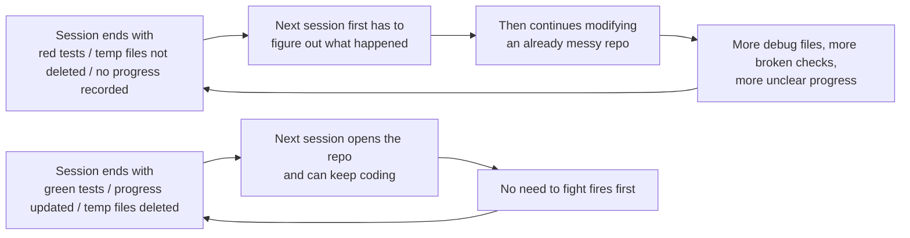

> Code examples: [code/](https://github.com/dsc-itnu/learn-harness-engineering/blob/main/docs/en/lectures/lecture-12-why-every-session-must-leave-a-clean-state/code/)
> Practice project: [Project 06. Build a Complete Agent Workspace](./../../projects/project-06-runtime-observability-and-debugging/index.md)

# Lecture 12. Leave a Clean Handoff at the End of Every Session

> Full templates and example snippets: [inline-examples](./code/inline-examples.md)

An agent works all afternoon, changes 20 files, commits, and the session ends. The next session finds a broken build, red tests, scattered debug files, a stale feature list and opaque progress, and spends 30 minutes working out what happened. OpenAI and Anthropic agree **long-term reliability depends on operational discipline, not just single-run success**: end-of-session state determines the next session's efficiency.

## Entropy Growth Is the Default State

Lehman's laws of software evolution: continuously changing systems grow more complex unless actively managed. Over five months of Codex experiments OpenAI saw that **agents copy patterns already in the repository, even inconsistent ones**, causing drift (one coffee cup invites another). The team first spent 20% of every Friday cleaning "AI slop," which doesn't scale. Their solution:

1. **Encode "golden rules" in the repo**: prefer the shared utility package over ad-hoc helpers; don't YOLO-guess data structures (validate boundaries or use typed SDKs). Mechanical, auto-checkable.
2. **Periodic cleanup workflows**: background Codex tasks scan for deviations, update quality scores and open targeted refactoring PRs, mostly auto-mergeable within a minute.
3. **Capture human taste once, enforce continuously**: review comments, refactor PRs and user-facing bugs become docs or tooling; when docs aren't enough, promote the rule into code.

Technical debt is a high-interest loan; small continuous payments beat one massive payoff.

> Source: [OpenAI: Harness engineering: leveraging Codex in an agent-first world](https://openai.com/index/harness-engineering/)

## Clean State: More Than "The Code Compiles"

Build passes, and all tests pass (including pre-existing ones, verified in CI, not "works on my machine"). Also: progress recorded in machine-readable artifacts (completed subtasks with criteria, in-progress with state, not started), cutting startup diagnosis by 60-80%; temporary artifacts removed (debug logs, temp files, commented-out code, TODOs); and the standard startup path working (environment init, codebase loading, context acquisition, task selection).

## Core Concepts

- **Clean state**: build passes, tests pass, progress recorded, no stale artifacts, startup path available; missing one means not "done."
- **Session integrity**: like a transaction, fully commit a clean state or roll back to the last consistent one.
- **Quality document**: active artifact scoring each module over time.
- **Cleanup loop**: routine maintenance that systematically reduces entropy.
- **Harness simplification**: periodically remove components the model no longer needs.
- **Idempotent cleanup**: same result however often run, safe under retry.

## "Clean Up Later" Means Never Clean Up

The next session can't tell which code is intentional versus temporary, and has its own task, so it builds on the chaos and adds more: a positive feedback loop. Observed over 12 weeks (build pass / test pass / startup time), also seen in an Electron app built with agents:

| Week | No cleanup | With cleanup |
|------|-----------|--------------|
| 1 | 100% / 100% / 5 min | 100% / 100% / 5 min |
| 4 | 95% / 92% / 15 min | |
| 8 | 82% / 78% / 35 min | |
| 12 | 68% / 61% / 60+ min, 103 stale artifacts | 97% / 95% / 9 min, 11 stale artifacts |

At week 12 the cleanup group's build pass rate was 29 points higher, test pass rate 34 points higher, startup 85% lower. The cleanup group ran a full clean-state check at every session end plus a weekly cleanup loop; the extra 5 minutes per session saved dozens of hours of chaos.

## How to Do It

1. **Clean state is necessary for completion**: session done = task verified AND clean state check passes. CLAUDE.md exit checklist: build passes, all tests pass, feature list updated, no debug code (console.log, debugger, TODO), standard startup (npm run dev) works.
2. **Dual-mode cleanup.** Immediate, every session end: remove temp artifacts, update feature list, ensure build and tests pass ("reference counting"). Periodic, weekly: full scan for structural issues, update quality documents, run benchmarks to detect drift ("tracing").
3. **Quality document.** Per-module grades with criteria: verification passing, agent understandable, test stability, architecture boundaries, code conventions. E.g. Authentication: A; Payment: C (payment callback untested, logic across 3 files, 2 flaky tests, boundary violations). New sessions fix the lowest first.
4. **Periodically simplify the harness.** Anthropic's initial harness split work into sprints for Sonnet 4.5; when Opus 4.6 shipped it could decompose work itself, making sprints overhead, and after removal the builder worked over two hours without drifting, more smoothly. But the evaluator still caught missing functionality and stubs near the model's capability boundary, so its value depends on task difficulty relative to model capability. Practice: monthly, disable one component, run benchmarks; remove it if results hold, otherwise restore or lighten. As models improve, the interesting harness combinations don't shrink, they shift; the engineer's job is finding the next valuable one.
5. **Idempotent cleanup**: e.g. `rm -f /tmp/debug-*.log`, `git checkout -- .env.local`, then `npm run test` to verify.
6. **High throughput changes merge philosophy.** OpenAI's agent opened 3.5 PRs per day (later more), so they minimized blocking merge gates: short-lived PRs, flaky tests resolved by later runs. Caveat: irresponsible at low throughput; the criterion is **average cost of fixing a bug vs. average cost of waiting for human review**. Merge fast when fixing is cheaper.

## Key Takeaways

- **Clean state is necessary for session completion**, part of the definition of done.
- **All five dimensions are non-negotiable**: build, tests, progress, artifacts, startup.
- **Quality documents make codebase health trackable.**
- **Periodically simplify the harness**; remove constraints models no longer need.
- **"Clean up later" equals never cleaning up**; only active cleanup counters entropy.

## Further Reading

- [Clean Code - Robert C. Martin](https://www.goodreads.com/book/show/3735293-clean-code) — Systematic principles of code cleanliness
- [Harness Engineering - OpenAI](https://openai.com/index/harness-engineering/) — Reproducibility as a core harness design requirement
- [Effective Harnesses - Anthropic](https://www.anthropic.com/engineering/effective-harnesses-for-long-running-agents) — The critical role of clean session exits for long-term reliability
- [Programs, Life Cycles, and Laws of Software Evolution - Lehman](https://ieeexplore.ieee.org/document/1702314) — Software evolution laws proving system complexity inevitably grows without active maintenance

## Exercises

1. **Clean State Checklist**: Design an exit checklist covering all five dimensions; apply over 5 sessions and record violations per dimension.
2. **Benchmark Comparison**: On a fixed task set, compare harness variants with and without clean-state requirements on completion rate, retries and defect escape rate.
3. **Harness Simplification Practice**: Disable one component, run benchmarks, and decide to keep, remove or replace it.
