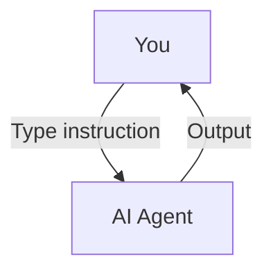
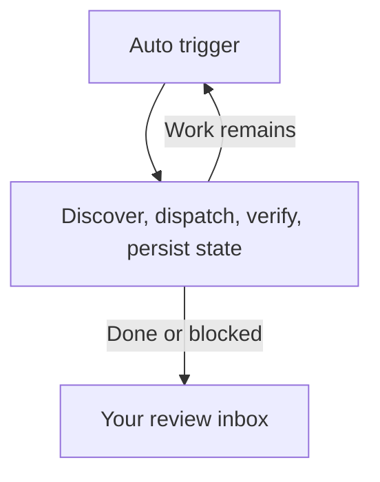
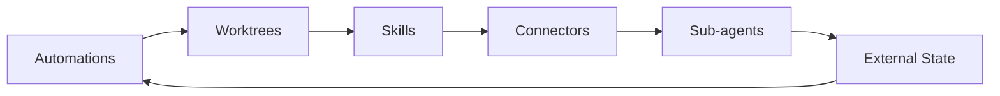
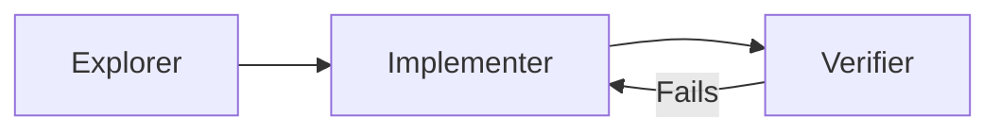
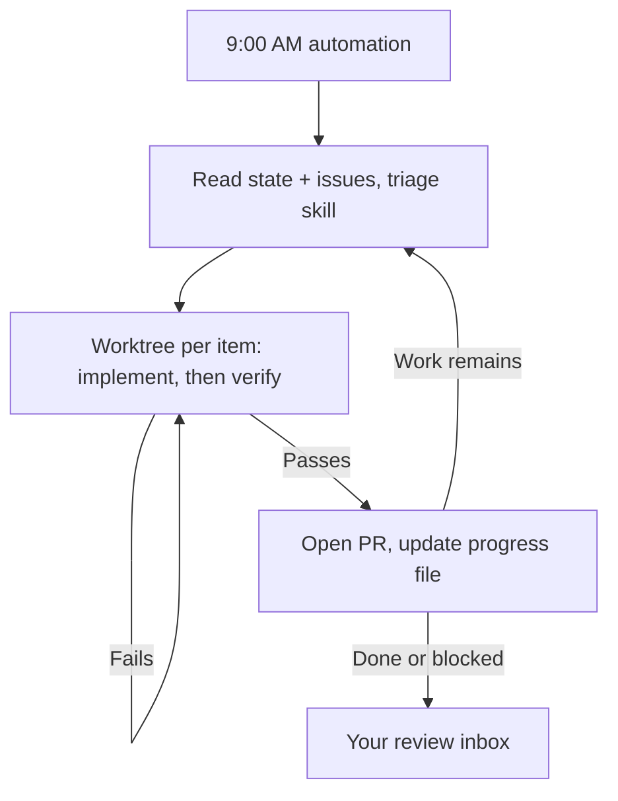
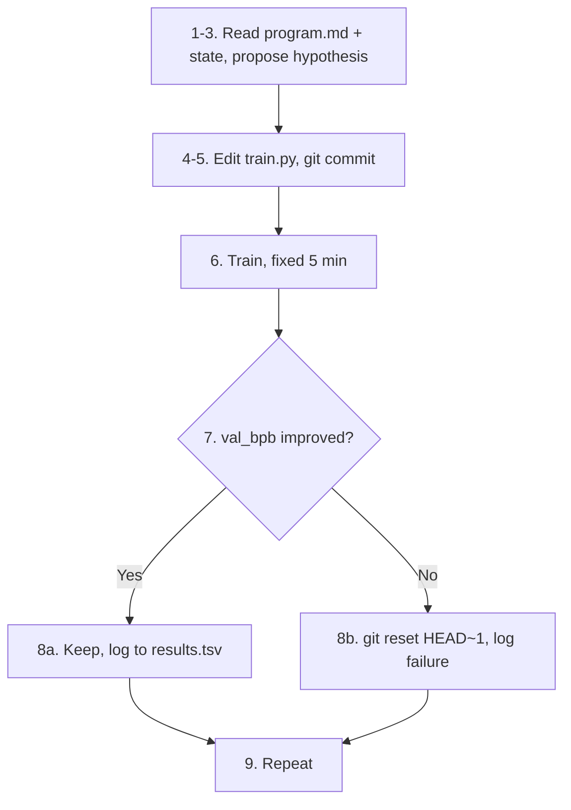

> Code examples: [code/](https://github.com/dsc-itnu/learn-harness-engineering/blob/main/docs/en/lectures/lecture-13-loop-engineering/code/)
> Practice project: [Project 07. Build Your First Automated Loop](./../../projects/project-07-loop-engineering-first-loop/index.md)

# Lecture 13. From Manual Prompting to Autonomous Loops

Lectures 1–12 assume **you are at the keyboard, typing instructions one at a time.** You wrote `AGENTS.md` (1–4), built state management (5–6), feature lists (7–8), clean handoffs (9, 12), and observability (10–11), but the trigger was always you. This lecture hands the start button to the system: not giving up control, elevating it.

## /goal: The Simplest Possible Loop

In early 2026, Claude Code and OpenAI Codex independently shipped `/goal`:

```
/goal "All tests pass, zero lint warnings, merge to main"
```

Eight hours later the agent has coded, tested, fixed, and merged, retrying on failure. Unlike a prompt (what to do next, run once, judged by you), you give the end state, the agent loops until a verifiable stopping condition says done, and you can walk away. `/goal` has three parts: **a goal, a verification method, and a stopping condition.** They move you from inside the loop to outside it.

### How `/goal` Grew Organically

(1) Manual one-by-one prompting, where you were the scheduler; (2) long multi-step prompts you still had to watch for drift; (3) self-directing agents that retried, but whose own "I'm done" can't be trusted since agents declare victory too easily; (4) **independent stopping judgment: `/goal`**, where an independent judge (another model, a script, a test command) decides "done", because the person writing the code can't grade their own homework. Everyone arrived here independently, hence the near-simultaneous launch.

### There's More Than One Kind of Loop

- **Turn-based** (normal chat): you type each prompt; for small, exploratory tasks.
- **Goal-based** (`/goal` in both; Codex needs manual enable): stops when an independent evaluator confirms or max turns hit; for clear completion criteria.
- **Time-based** (Claude Code `/loop`, Codex thread automation): scheduled interval, stopped by you or on exit; polling and periodic checks.
- **Event-driven** (Claude Code Routines via API / GitHub Webhook; Codex standalone automation + plugins): PR opened, CI failed, new issue; stops after handling or at retry limit; reactive and CI/CD work.

### Don't Confuse `/goal` and `/loop`

`/goal` is one big task (a marathon), hours or days, closer each iteration, ending at goal or budget exhaustion ("Implement the full payment system with test coverage"). `/loop` is one small action (an alarm clock) repeated on an interval, each run independent, no cumulative progress ("Check if CI is broken every 15 minutes"). The classic mistake is `/loop 10m "keep implementing the payment system"`: it doesn't remember where it left off. **Test: does this thing have an end?** Yes → `/goal`; no → `/loop`.

Loop Engineering is **designing systems that combine all these types so your agent keeps working when you're not there**, adding scheduling, parallelism, isolation, and memory to goal, verification, stopping condition.

## June 2026: Three People Lit the Same Fuse in One Week

In the first week of June 2026, three practitioners, without comparing notes, said the same thing.

**Peter Steinberger** (creator of OpenClaw, [post reached 8 million views](https://x.com/steipete/status/2063697162748260627)): "You shouldn't be prompting coding agents anymore. You should be designing loops that prompt your agents."

**Boris Cherny** (head of Claude Code at Anthropic, [on the Acquired podcast](https://x.com/rohanpaul_ai/status/2063289804708835412)): "I don't prompt Claude anymore. I have loops running that prompt Claude and figure out what to do. My job is to write loops."

**Addy Osmani** (engineering lead at Google Chrome) [named the concept](https://addyosmani.com/blog/loop-engineering/) on June 7, 2026:

> **Loop engineering is replacing yourself as the person who prompts the agent. You design the system that does it instead.**

Cherny's numbers: over 30 consecutive days all Claude Code contributions were made autonomously by AI: 259 merged PRs, over 80% of production code authored by Claude, a 76% success rate on open-ended software tasks. The infrastructure crossed a threshold: agents finish non-trivial tasks unattended, scheduling primitives (`/loop`, `/goal`, cron) ship in the tools, and runs are cheap enough to repeat.

> Source: [Osmani: Loop Engineering](https://addyosmani.com/blog/loop-engineering/)

## Inside the Loop vs. Outside the Loop

**Scenario A: You are inside the loop (Lectures 1–12).**



Full harness (`AGENTS.md`, `feature_list.json`, `init.sh`, `claude-progress.md`), **but every step needs your initiation.** You are the engine.

**Scenario B: You are outside the loop (Loop Engineering).**



Your job: **define goal and stopping condition beforehand, review output afterward, adjust rules when it veers off.** Leverage moves from the right prompt to the right loop.

> Osmani: "A year ago if you wanted a loop you wrote a pile of bash and you maintained that pile forever and it was yours and only yours. Now the pieces just ship inside the products."

## Core Concepts

**Loop Engineering** (a system prompts your agent), **`/goal`**, **Generator/Evaluator Separation**, **Worktree Isolation**, **External State** (memory on disk), and the **Four Silent Costs**, all defined below.

## The Six Primitives of a Loop

Osmani's five building blocks plus a memory layer; External State is the spine.



### 1. Automations — The Heartbeat

Without automation a loop is a one-off run. Claude Code, lightest to heaviest: **`/loop`** (in-session, auto-expires after 7 days), **Desktop scheduled tasks** (machine on, local files), **Cloud Routines** (machine off, 1-hour minimum, schedule/API/GitHub webhook triggers), **GitHub Actions / cron**. Codex: **thread automation** (like `/loop`), **standalone automation** (fresh runs into a Triage inbox, like Desktop tasks), `codex exec` + cron; no native cloud scheduler. OpenAI uses them for daily issue triage, CI summaries, commit briefings, and hunting last week's bugs.

```bash
/loop 30m Run the test suite and fix any failing tests
```

### 2. Worktrees — Isolation at Scale

`git worktree` gives each agent its own branch and directory (`--worktree`, or `isolation: worktree` on a sub-agent). **Your review bandwidth is still the ceiling** on parallel agents.

### 3. Skills — Stop Re-Explaining Your Project

A folder with a `SKILL.md` (same format in Codex and Claude Code; `/skill-name`, Codex also `$skill-name`, or implicit). Skills pay your intent debt: a cold agent fills gaps with confident guesses, so conventions and "we don't do it this way because of that one incident" are written once.

### 4. Connectors — Your Loop Touches Real Tools

Connectors (MCP, both tools) let the agent read your tracker, query a database, hit staging, post to Slack: the difference between "here is the fix" and opening the PR and pinging the channel once CI is green.

### 5. Sub-agents — Keep the Maker Away from the Checker



Claude Code's `/goal` has a fresh session judge when to stop: **generator/evaluator separation**, the key reliability guarantee.

### 6. External State — The Loop's Memory

A markdown file or Linear board recording done, in progress, next. The agent forgets; the repository doesn't. You don't need all six every time.

## A Complete Loop, Anatomized



You review the inbox, decide, and refine skills and rules. Cherny used this pattern to merge 259 PRs in 30 days without opening an IDE; OpenAI engineers used it to build a roughly one-million-line beta product without writing a line by hand.

## Generator/Evaluator Separation: Why You Can't Let the Model Grade Its Own Work

The hardest lesson in loop engineering. An agent asked to grade its own code scores itself high: authorship, not dishonesty. **A model is its own output's best defense attorney.** Never let the same entity work and review:

- Claude Code's `/goal` uses an independent supervisor session.
- Codex sub-agents allow a verifier with a different model and reasoning effort.
- Community "adversarial verify" spawns N independent skeptics per finding, each prompted to refute; majority rejection kills the finding.

**Someone in your crew must not believe you.**

## Karpathy's autoresearch: The Loop Exemplar

[Karpathy's autoresearch](https://github.com/karpathy/autoresearch), a 630-line Python project released March 2026, runs all night on one GPU and a research direction, completing hundreds of ML experiments and keeping only real improvements. It hit 66,000+ stars within days.

### Three Files, Three Roles

`prepare.py` (read-only data prep, tokenizer, eval harness), `train.py` (~630 lines, the **agent** edits anything), `program.md` (**you** write the research methodology). **Humans don't touch code, they touch direction; agents don't touch direction, they touch code.**

### Input: What program.md Looks Like

Goal (optimize `val_bpb`, validation bits per byte, lower is better), constraints (don't touch `prepare.py`, VRAM budget, fixed 5-minute training), exploration directions, evaluation rules, and the iron rule: never stop. Kickoff: `Have a look at program.md and let's kick off a new experiment!`

### The Nine-Step Ratchet Loop

A **ratchet** only moves forward:



About 12 experiments per hour, ~100 overnight; Karpathy ran it 2 days, ~700 experiments. The fixed 5-minute budget makes all experiments comparable.

### Output: What You See When You Wake Up

A forward-only git history (`git log` is a validated research log), `results.tsv` logging every experiment (hash, `val_bpb`, `vram_mb`, description), and the agent's own commit-message research log.

### What It Actually Found

In the initial 2-day, ~700-experiment run: about **20 stackable real improvements** (learning rate, optimizer tuning, activation swaps, attention patterns), cutting nanochat's GPT-2-level training time on 8×H100 from **2.02 to 1.80 hours**, about **11% faster**: small stacking gains, but weeks of human work done in 48 hours.

### The Most Telling Detail: The Loop Is Written in English, Not Code.

`program.md` is a methodology (**never ask for human help, just keep going**) executed indefinitely. Don't give the agent a task, give it a **methodology**; let it be the loop.

## Four Silent Costs

1. **Verification Debt.** "Looks fine" is not "confirmed correct." **Stopping conditions must be machine-checkable, never "feels about right."**
2. **Comprehension Rot.** The faster a loop ships, the further your understanding drifts; Cherny's team had 80% agent-authored code. **Fast loops require fast reading.**
3. **Cognitive Surrender.** The comfortable posture is to stop having opinions. Osmani: "Two people can build the exact same loop and get opposite results. One uses it to go faster on work they understand; the other uses it to avoid understanding the work. The loop doesn't know the difference. You do."
4. **Token Blowout.** Context accumulates; prompt size grows roughly quadratically with turns. Codex uses automatic context compaction (older turns compressed into encrypted summaries). Handle it from the first loop.

## Building Your First Loop

Skip the Stripe-scale pipeline merging 1,300 PRs a week. (1) Pick a task you repeat twice a week; (2) write a goal and stopping condition (e.g. triage the 10 newest issues, stop when done or a human decision is needed); (3) split implementer and verifier; (4) keep a markdown memory file; (5) run it daily via `/loop` or cron for a week.

### The Maturity Ladder

1. **Level 1: Goal Runner** — `/goal` with a stopping condition.
2. **Level 2: Scheduled Single-Task** — one automation on a timer (e.g., morning CI check).
3. **Level 3: Multi-Agent Loop** — maker/checker split; each finding forks an isolated worktree.
4. **Level 4: Self-Feeding Loop** — discovers its next task from external state.
5. **Level 5: Fleet Orchestration** — parallel loops sharing a memory layer.

Most teams are at Level 2–3; Level 1 returns fastest.

## Key Takeaways

- **Loop Engineering does not replace Harness Engineering — it builds one floor above it.** The harness makes single runs reliable. The loop makes continuous runs autonomous.
- **`/goal` is the simplest possible loop:** goal + verification + stopping condition. Those three things move you from inside the loop to outside it.
- **Six primitives (Automations / Worktrees / Skills / Connectors / Sub-agents / External State) are the loop's building blocks.** Not all of them every time, but you need to know when to reach for which.
- **The maker and the checker must be separated.** A model grading its own work is untrustworthy. An independent verifier — sometimes a different model altogether — is the baseline reliability guarantee of any loop.
- **Loops make generation nearly free and leave judgment as the scarce resource.** The time you save isn't for resting. It's for making more judgments.
- **Four silent costs grow sharper as loops run longer:** verification debt, comprehension rot, cognitive surrender, token blowout. Loops accelerate output — and risk.
- **Start small.** One `/goal`, one cron, one markdown memory file. See the return, then stack upward.

## Further Reading

- [Osmani: Loop Engineering](https://addyosmani.com/blog/loop-engineering/)
- [Osmani: Harness Engineering](https://addyosmani.com/blog/agent-harness-engineering/)
- [Willison: Agentic Loops](https://simonw.substack.com/p/designing-agentic-loops)
- [Karpathy: autoresearch](https://github.com/karpathy/autoresearch)
- [Dynamic Workflows](https://kenhuangus.substack.com/p/claude-code-orchestration-dynamic)
- [Loop Library](https://signals.forwardfuture.ai/loop-library/) (50 real loops)
- [The Neuron: Agent Loops](https://www.theneuron.ai/explainer-articles/claude-code-creators-boris-cherny-and-cat-wu-explain-how-to-use-agent-loops/)
- Lecture 12: [Clean Handoff](./../lecture-12-why-every-session-must-leave-a-clean-state/index.md)
- Lecture 5: [Continuity](./../lecture-05-why-long-running-tasks-lose-continuity/index.md)
- Lecture 11: [Observability](./../lecture-11-why-observability-belongs-inside-the-harness/index.md)
- Lecture 8: [Feature Lists](./../lecture-08-why-feature-lists-are-harness-primitives/index.md) (data source for self-feeding loops)

## Exercises

1. **Turn a recurring task into a `/goal`:** define goal, verification, stopping condition; compare with manual.
2. **Separate maker and checker:** use different models for implementer and verifier; the verifier cites evidence; compare issues found.
3. **Give your loop a memory:** a markdown state file (done, verification, pass/fail/blocked, next); run three rounds with and without it.
4. **Audit silent costs after an hour:** "feels right" vs machine-confirmed checks, can you explain the code, how often "I'll look later", is context bloating?
