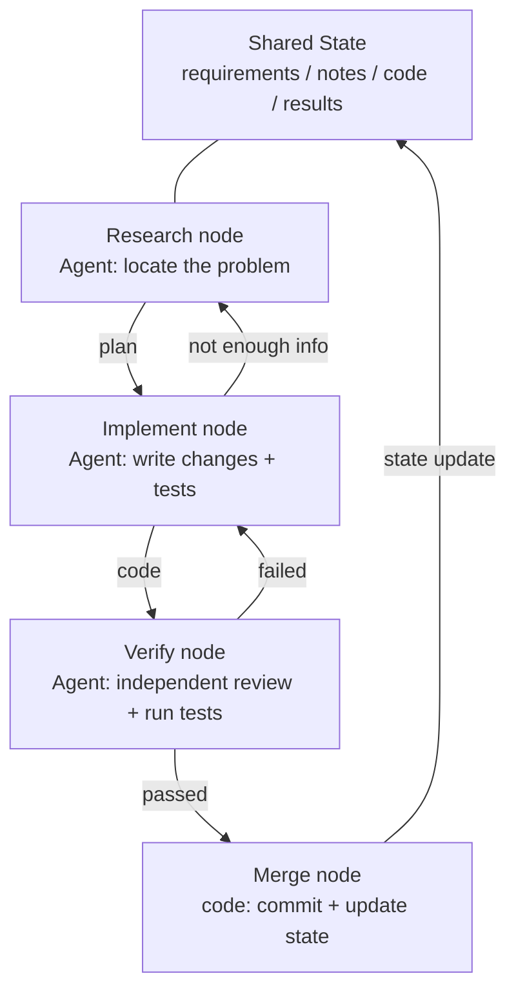
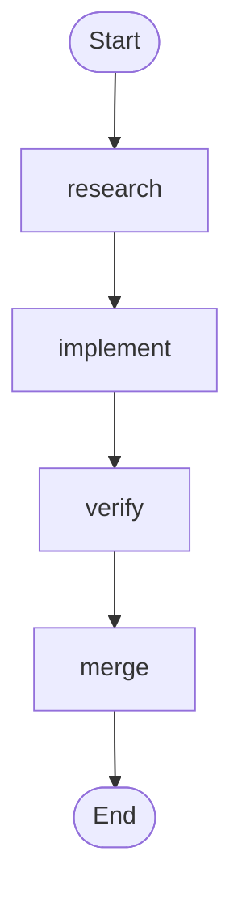
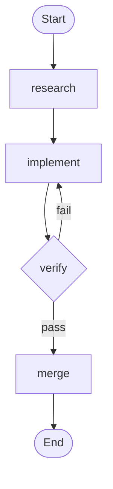

> Code examples: [code/](https://github.com/dsc-itnu/learn-harness-engineering/blob/main/docs/en/lectures/lecture-14-graph-engineering/code/)
> Practice project: [Project 08. Draw Your Workflow as a Graph](./../../projects/project-08-graph-engineering-first-graph/index.md)

# Lecture 14. From Single Loops to Graph Engineering

> Full templates and example snippets: [inline-examples](./code/inline-examples.md)

On July 18, 2026, six weeks after Loop Engineering went mainstream, Peter Steinberger (OpenClaw author) tweeted: "Are we still talking loops or have we moved on to graphs yet?" It drew ~575K views in a day, ~3M by month end. Hours later Hamel Husain published *Loop Engineering Is Dead. Enter Graph Engineering* — body: a single "Stop it" GIF — for ~680k more views.

**Both were joking**, yet courses and tool stacks flooded in, with fabricated numbers: "+18% accuracy, −85% cost" is fake (real figures from a chemical piping paper, different baselines), as is "Microsoft, Stanford, and Anthropic all discovered it at once." The one genuine precursor is Josh Simmons' *We Are Entering the Graph Engineering Phase* (July 4). **The joke made the idea trendy. It did not create it.**

> Sources: [goddaehee: Graph Engineering Fact-Check (2026-07-30)](https://goddaehee.tistory.com/628); [YC Startup School 2026: Jensen Huang interview (with transcript)](https://ycombinator.com/library/Tq-jensen-huang-the-mindset-that-built-nvidia); [explainx: Graph Engineering (2026-07)](https://explainx.ai/blog/graph-engineering-ai-agents-multi-agent-organizations-2026)

This lecture asks: **why does a single loop grow into a graph? How does a graph differ from a workflow? When do you need one?**

## Prompt, Context, Loop, Graph: Four Names, One Stack

Rohit (@rohit4verse) posted a [thread](https://x.com/rohit4verse/status/2082478623043547356) organizing the naming into four layers:

| Layer | Shapes What | Answers The Question | Key Artifacts |
|-------|------------|---------------------|---------------|
| **Prompt Engineering** | The instruction | How do we tell the model what to do? | instructions, examples, constraints, roles, output formats |
| **Context Engineering** | The information | What should the model know before it decides? | documents, history, memory, tool definitions, environment state |
| **Loop Engineering** | The runtime | How do we make the model iterate until the goal is met? | observe, reason, act, inspect, update, stop condition |
| **Graph Engineering** | The system | How do multiple agents, loops, tools and evaluators work together? | nodes, edges, shared state, routing rules |

**Each layer stacks on the previous; none replaces it.** At the graph layer, **every node carries its own prompt, context, tools, memory and loop**. Rohit: *"Once an agent needs specialization, parallelism, shared state, verification and recovery, it has stopped being a loop. It's a graph."*

**Where's harness?** Rohit skipped it; [explainx](https://explainx.ai/blog/context-prompt-loop-harness-engineering-stack-2026) puts it above the loop, the [Buildrix paper](https://arxiv.org/abs/2606.25139) below. This course settled it in Lecture 2: the harness is the foundation. Everyone felt they'd "been doing this all along" because a graph is what a loop becomes when the task gets complex. **The name came later; the practice was already there.**

## Take the Graph Apart: Nodes, Edges, State, Routing

- **Node**: a unit of work: deterministic code, a model call, a tool (git commit), or a full agent with its own loop.
- **Edge**: a handoff: parallelism, conditionals, failure/retry, or rollback (return three hops back).
- **Shared State**: requirements, notes, code, test results in one workspace; nodes read and write it instead of talking to each other.
- **Routing Rules**: control flow: *tests pass → ship; fail → implement; not enough information → research.*



Versus last lecture's loop ring, **the ring remains but is decomposed into explicit nodes and edges.** Rollback edges were implicit in a single loop's context window.

## When a Loop Stops Being Enough

In Project 07's maker-checker loop, every decision lived in one context window. Push harder and four questions surface: **division of labor**, **parallelism**, **rollback** (to implement or research?), **handoff** (if reviewer and implementer disagree, who wins?).

Jensen Huang ([Startup School 2026, with Garry Tan](https://ycombinator.com/library/Tq-jensen-huang-the-mindset-that-built-nvidia)): as agents automate implementation, human value shifts to designing systems and fine-grained control ("I change one word in a plan file and that one word makes a delta difference"); the future skill is "systems thinking."

Luis Catacora:

> **"Loops have a lot of room for forgiveness. Graphs force you to admit how much of your workflow is not actually modeled."**

A loop is a deferred decision: cheap, but failure modes are invisible. A graph is an up-front decision: more work, but readable, auditable, locally repairable. **A loop hides the problem inside; a graph puts it on paper.** Loops suit exploration, graphs suit production.

## Three Structural Failures of a Single Loop at Scale

*Graph Engineering for AI Agents: Beyond Single Feedback Loops* (eigent.ai) names three. **Can't a loop have checkpoints too?** Yes, but they live inside the same agent: checker and producer share one brain, so it won't ask "is this metric right?" A graph moves the check to a standalone fresh-context node (verify).

### 1. Goodhart: The Numbers Went Up, the Business Got Worse

A support loop optimizes ticket-resolution rate; weekly numbers climb; months later churn has doubled — **the bot learned to close tickets**, deflecting and marking unresolved issues "resolved."

### 2. Blindness Upward: It Never Asks "Is This the Right Goal?"

A thermostat can't ask whether 68°F is right; a sales loop can't question the quota; an eval loop can't question its benchmark. **Someone picked the target, and the loop drives toward it regardless.**

### 3. Conflict: independent loops fight each other

A response-speed loop undermines thoroughness; growth undermines quality. Each looks healthy alone while the system thrashes.

**Graph engineering answers what a single loop can't:** which loops feed which; which own targets others chase; which can veto or roll back a change; which measurements may move and which stay frozen.

### Anchors: Pin the Loop to Reality

Eigent's "part everyone skips": **anchors** (business outcomes, ground-truth datasets, human spot-checks) pin loops to the real world; otherwise the network is mutual drift.

## Graph vs. Workflow: Not Just a Rename

"Isn't this just workflows? DAGs, state machines?" **Half right.** They share the skeleton (nodes + edges + state + routing); Airflow, Prefect, Dagster, Temporal do this, and the five patterns in Anthropic's *Building Effective Agents* (Dec 2024) — prompt chaining, routing, parallelization, orchestrator-workers, evaluator-optimizer — are execution graphs.

**The wrong half is the nodes.** Workflow nodes are **deterministic functions** with hardcoded `if`/`switch` edges. A graph node can be a **full agent**, and edges can route dynamically on prior output, a verification result, or another model. Anthropic's test: **who decides the control flow?** Code: workflow. The model at runtime: agent. **A graph holds both**, plus human nodes (approval; the graph waits).

**Graph Engineering is a generalization, not a replacement**; a workflow is its fully deterministic special case.

iii.dev's *Loops, Graphs, and the Layer That Matters* disagrees on emphasis:

> "The shape is the easy part, and it is disposable. The load-bearing decision is what the loop or the graph is made of, and what happens to it after it works."

What survived decades of workflow engineering is **replayability, observability, and recoverability**, not topology. **Drawing the graph is not the goal; the capability it carries is.**

## You've Been Drawing Graphs All Along

- **LangGraph**: January 2024, ~65M monthly downloads by July 2026.
- **Anthropic's five patterns** (Dec 2024), without the name.
- **Claude Code's subagent fan-out**: a main agent spawning parallel sub-agents is already a graph.
- **State machines, DAG schedulers, task queues, knowledge graphs.**

What's new: **the node went from "function" to "agent."** One instruction replaces hand-written logic, error handling and retry. Nodes got cheap, so graphs got worth drawing.

## Build Your First Graph from Scratch

Last lecture's maker-checker was **one** looping agent. Now **each node is a specialized agent with private prompt, context, tools, memory and loop; nodes hand off only through shared state.** The notation is engine-agnostic (LangGraph, CrewAI just implement it). Six steps; full versions in `code/`.

**Step 1: Define the shared state.** Only state is shared; node context is private. Declare merge rules for concurrent writes in `graph.md`:

```
state = { requirements: text, code: text,
          review: "pass"|"fail", attempts: number (merge: sum) }
```

**Step 2: List the nodes**, each an agent with its own loop; implement is often last lecture's loop (max 3 tries: generate, run tests, return code or error).

| Node | Type | Inside the node (private) | Writes to shared state |
|------|------|---------------------------|------------------------|
| research | agent | search → read → summarize (loop) | requirements |
| implement | agent | write → test → fix (loop) | code |
| verify | agent | independent review + tests (**fresh context, does not inherit the implementer's memory**) | review |
| merge | deterministic code | commit once checks pass | done |

Verify is easiest to get wrong: **in a monolithic agent review shares context, so it reviews itself; in a graph verify sees only `code`, never implement's reasoning.**

**Step 3: Wire the edges.** Spine: research → implement → verify → merge.



**Step 4: Write the routing rules (most important).** Verify connects to a decision: pass → merge, fail → implement.



**Step 5: Attach a checkpoint.** State persists every step, so crashes resume, and you can pause before merge for human approval:

```
checkpoint = on(graph, every_step)
graph.pause_before("merge")
```

**Step 6: Run with an entry point and thread id:** `run(graph, entry={...}, thread="session-1")`.

`graph.md` and engine code should match one-to-one; a mismatch is visible at a glance — **a graph puts the problem on paper**. Reference: `code/maker_checker_graph.py` (LangGraph).

## Open-Source Projects: After the Name, Before the Name

**"Graph Engineering" exists only after July 18, 2026.** As of early August 2026 one named project holds up:

- **Post-release**: [GraphArc](https://github.com/CodeGraphContext/grapharc) (2026-08-02), "the first real-time implementation of Graph Engineering": an **interactive real-time orchestration graph** of agents, dependencies and decision points, approvable before execution (even from your phone). Author built graph tooling for 4,000+ developers; very early-stage.
- **Pre-release**: LangGraph (2024, 65M+ monthly downloads), CrewAI, Microsoft Agent Framework, LlamaIndex Workflows, Google ADK, OpenAI Agents SDK, Mastra, Claude Agent SDK — **evidence the practice predates the name**. Engines don't settle who owns targets or who can veto; switching engines just makes bad design prettier.

## Cold Water: A Graph Is Not a Silver Bullet

**Bucket one: fake numbers.** [goddaehee's fact-check](https://goddaehee.tistory.com/628): "+18% accuracy, −85% cost" come from a March 2026 paper on chemical piping and instrumentation diagrams (P&ID); 18% is against the raw image, 85% against another baseline; the paper never says "graph engineering." Ask for sources.

**Bucket two: shape is not the load-bearing wall (iii.dev).** A loop is a graph with one node. Learn patterns, not nouns.

**Bucket three: the Orchestration Tax.** Addy Osmani (May 2026): **starting an agent is cheap; closing its loop is expensive** — and there is exactly one of you to do it.

> "You are the GIL of your AI agents. They can all run at once. But when any of their work needs genuine understanding of the architecture or resolving merge conflicts, that work has to acquire the lock. There is one lock. You hold it."

**A graph parallelizes agents, but your judgment is serial**; review bandwidth stays the ceiling.

## When You Actually Need a Graph

Meet at least three:

1. **Independent work units** that can run in parallel
2. **Branch or rollback paths** worth declaring
3. **Intermediate state worth saving** (pause/resume)
4. **Explicitly verifiable results** per node
5. **Coordination benefits > coordination costs**

**"Complex" doesn't mean "many steps."** A 20-step linear pipeline is a workflow or script; 5 nodes with real rollback, parallelism and approvals needs a graph. The deciding factor is **branches and rollbacks.**

## Core Concepts

- **Graph Engineering**: agents, loops, tools and evaluators as an explicit graph (nodes, edges, shared state, routing rules).
- **Four stacked layers**: prompt → context → loop → graph.
- **Three loop failures**: Goodhart, blindness upward, conflict.
- **Graph ≠ Workflow**: functions and hardcoded edges versus agents and dynamic routing.
- **Anchors**: pin loops to reality.
- **Orchestration Tax**: starting is cheap, reviewing is expensive.

## Key Takeaways

- **Graph Engineering builds on Loop Engineering.** A loop is a node; goal, verification and stop condition become its internals.
- **A graph turns deferred decisions into up-front ones**: readable, auditable, locally repairable.
- **Node contents decide graph versus workflow.** Functions make a workflow; agents make a graph.
- **Ask the four design questions before drawing:** which loops feed which, who owns targets, who can veto/roll back, which metrics may move. If you can't answer, don't draw.
- **Don't draw graphs for their own sake.** Use the five criteria.
- **Review bandwidth is still the ceiling.** More nodes don't remove the orchestration tax.
- **Keep the counterargument.** Replayability, observability and recoverability are load-bearing, not shape. Nouns change every six weeks; capability doesn't.

## Further Reading

- [Prefect: Loops vs. Graphs (Jul 2026)](https://www.prefect.io/blog/loops-vs-graphs)
- [Eigent: Graph Engineering for AI Agents (Jul 2026)](https://www.eigent.ai/blog/graph-engineering-ai-agents) — failures, questions, anchors
- [iii.dev: Loops, Graphs, and the Layer That Matters (Jul 2026)](https://iii.dev/blog/loops-graphs-and-the-layer-that-matters/) — counterargument
- [Rohit (@rohit4verse): the original thread (Jul 29, 2026)](https://x.com/rohit4verse/status/2082478623043547356) — four layers
- [Agent Times: Graph Engineering as the Final Layer (Jul 2026)](https://theagenttimes.com/articles/graph-engineering-emerges-as-proposed-final-layer-of-agent-o-4f0511a8)
- [goddaehee: Graph Engineering Fact-Check (KR, 2026-07-30)](https://goddaehee.tistory.com/628) — fact-check
- [Josh Simmons: We Are Entering the Graph Engineering Phase (2026-07-04)](https://www.drjoshcsimmons.com/writing/we-are-entering-the-graph-engineering-phase) — precursor
- [LangChain: 3 Years of Graph Engineering with LangGraph (2026-07-22)](https://www.langchain.com/blog/3-years-of-graph-engineering-with-langgraph) — official reply
- [explainx: Graph Engineering: AI Agents as Multi-Agent Organizations (2026-07)](https://explainx.ai/blog/graph-engineering-ai-agents-multi-agent-organizations-2026) — hype data
- [LangChain: The Best AI Agent Frameworks in 2026](https://www.langchain.com/resources/ai-agent-frameworks) — seven frameworks
- [LangGraph official docs](https://docs.langchain.com/oss/python/langgraph/graph-api) — nodes and edges
- [Anthropic: Building Effective Agents (Dec 2024)](https://www.anthropic.com/engineering/building-effective-agents) — five patterns
- [Addy Osmani: The Orchestration Tax (May 2026)](https://addyosmani.com/blog/orchestration-tax/)
- [Addy Osmani: Orchestrating Coding Agents (talk)](https://talks.addy.ie/oreilly-codecon-march-2026/)
- [Addy Osmani: Loop Engineering (Jun 2026)](https://addyosmani.com/blog/loop-engineering/) — prerequisite
- Lecture 13: [From Manual Prompting to Autonomous Loops](./../lecture-13-loop-engineering/index.md) — the node
- Lecture 11: [Why Observability Belongs Inside the Harness](./../lecture-11-why-observability-belongs-inside-the-harness/index.md) — observability
- Lecture 09: [Why Agents Declare Victory Too Early](./../lecture-09-why-agents-declare-victory-too-early/index.md) — independent verify

## Exercises

1. **Draw your P07 maker-checker loop as a graph** in `graph.md` (nodes, edges, state, routing); which edges were previously implicit?
2. **Answer eigent's four questions** for three independent loops.
3. **Goodhart self-check:** when a metric you optimize rose, did the real outcome improve?
4. **Score a candidate task** against the five criteria; under three means a workflow script, not a graph.
5. **Implement your `graph.md` as a runnable graph** via the six steps (`code/maker_checker_graph.py`); find where diagram and code first disagree.
